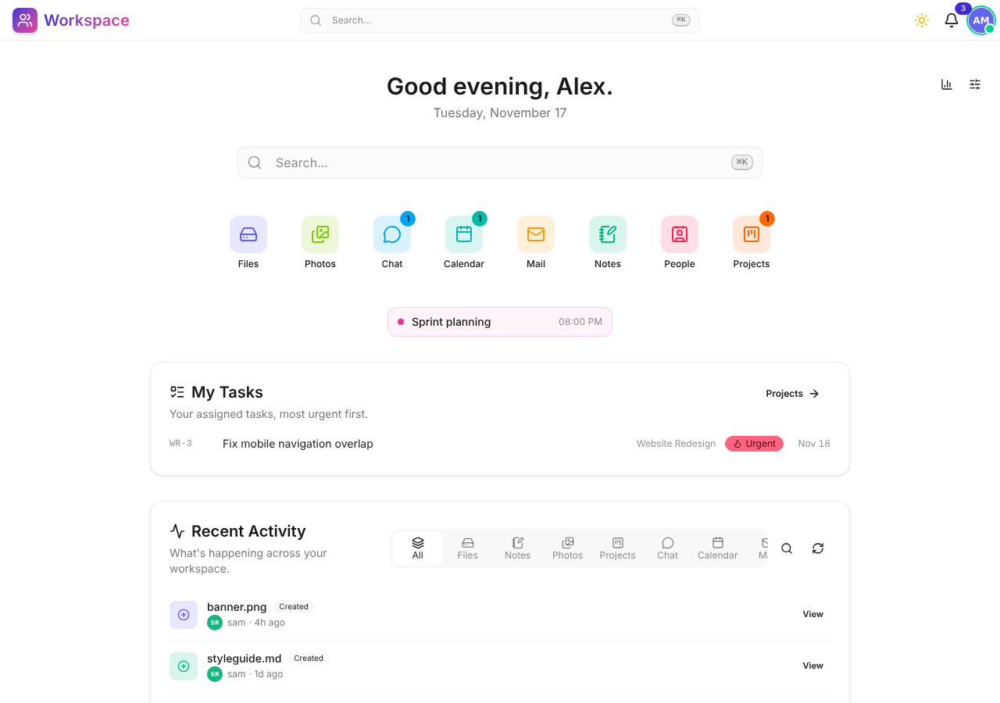
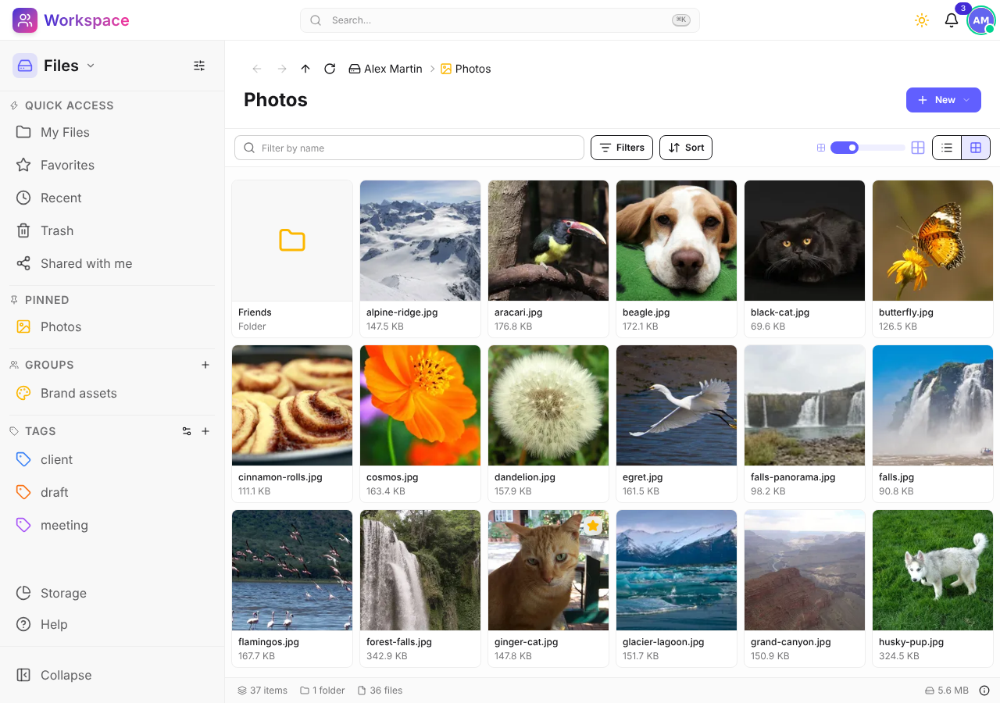
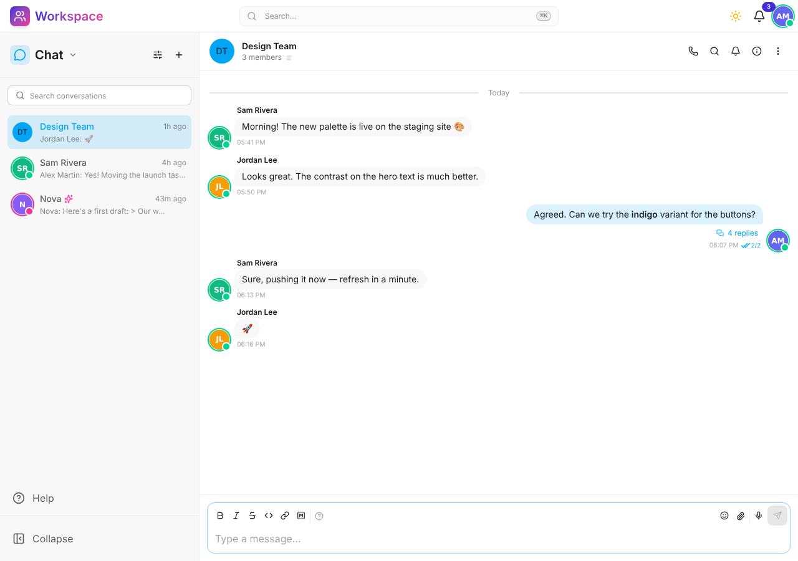
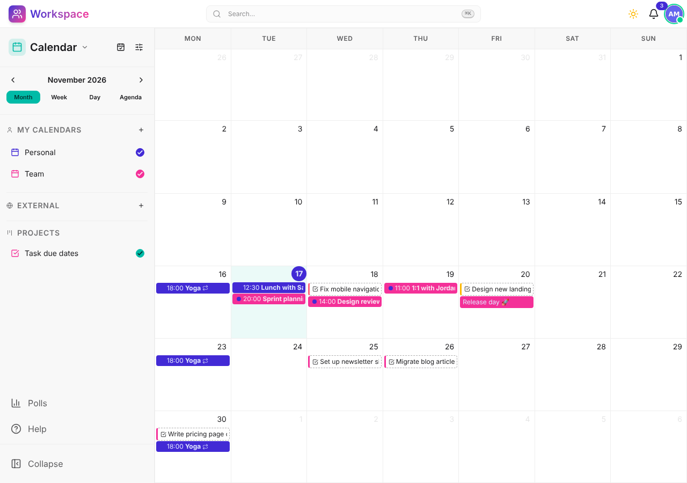
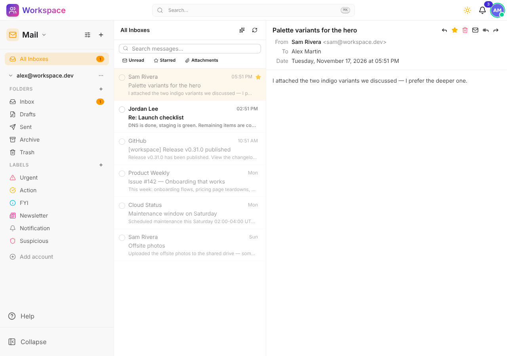
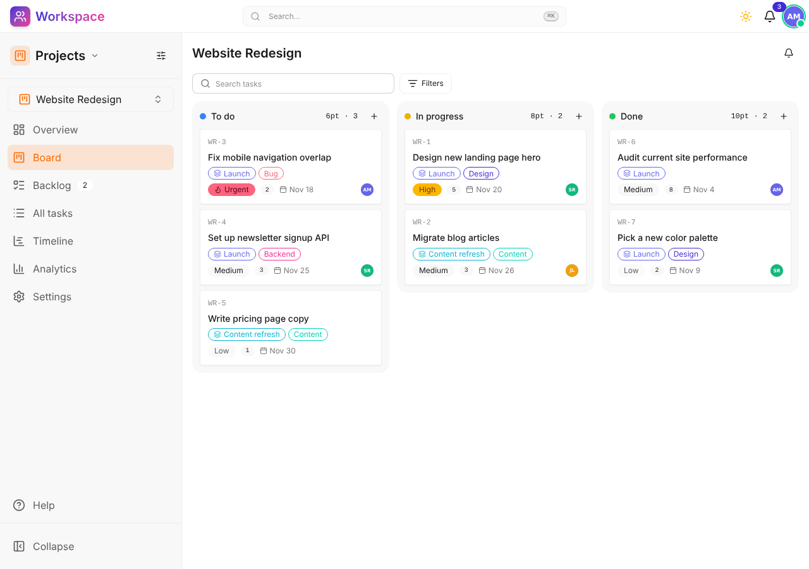
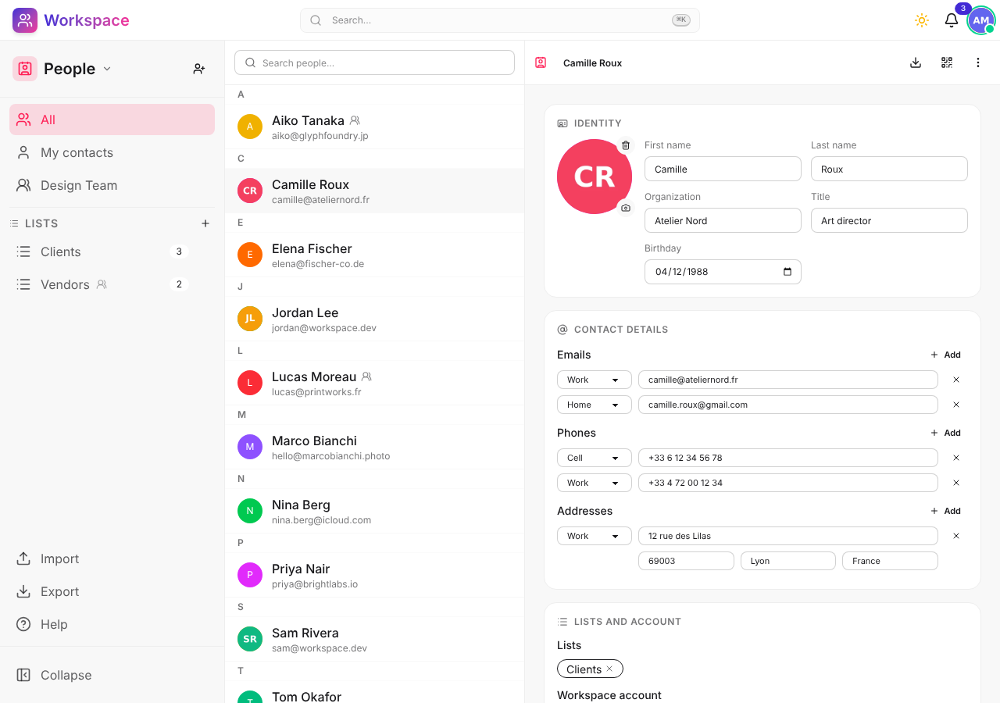
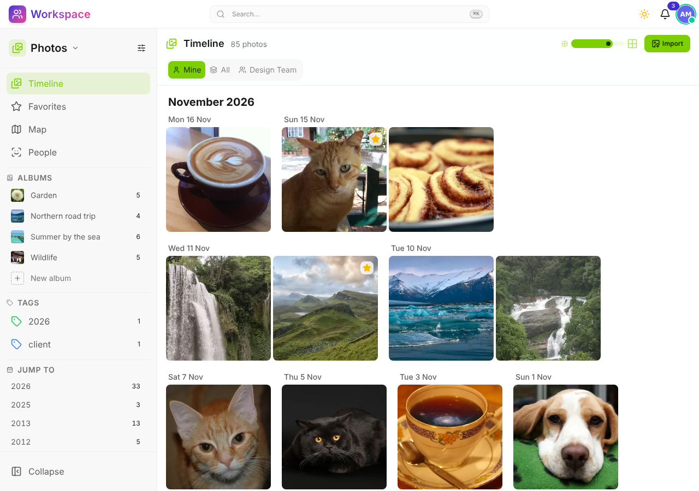
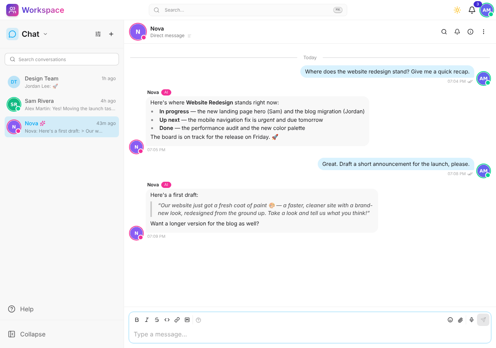
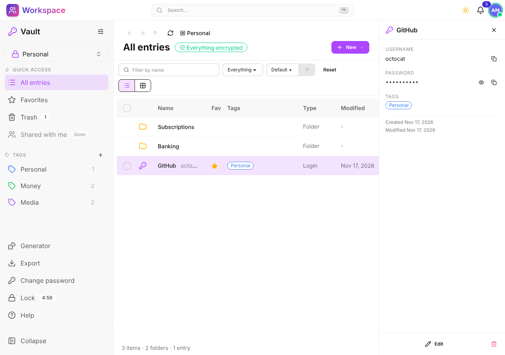

# Workspace

> **Early Development** - APIs, schemas, and features may change without notice. Use at your own risk.

A self-hosted productivity suite built with Django. Files, chat, email, calendar, AI assistants, and more - in a single platform you control.

From a Raspberry Pi to a Kubernetes cluster. One app, any scale.



## Features

### [Files](docs/files/)
The file manager behind Notes and Photos: folders and resumable drag-and-drop uploads, viewers and editors for images, PDF, Markdown, code, video, e-books and (with a WOPI editor) office documents, and sharing with people, groups and public links that can also accept uploads. Group folders, tags, a storage analysis view, trash, WebDAV access and optional ClamAV malware scanning.



### [Chat](docs/chat/)
Direct and group conversations with live delivery, threads, mentions, reactions, read receipts, attachments and voice messages. Built-in audio and video calls with screen sharing, per-conversation notification levels and group admins.



### [Calendar](docs/calendar/)
Month, week, day and agenda views with recurring events, guests from your address book, RSVP and email invitations. Scheduling polls that guests can vote on without an account, two-way CalDAV sync with phones and desktop apps, read-only subscription links and external ICS feeds.



### [Mail](docs/mail/)
An IMAP/SMTP client for Gmail, Microsoft 365 or any provider, with one inbox for every account, labels, filters and rules, recipient suggestions from People, and optional AI sorting, summaries, drafting and event extraction.



### [Notes](docs/notes/)
A Markdown notebook stored in Files, with folders, group folders, tags, favorites and a daily journal. Link notes with `[[`, embed any file with `
Task boards for solo or team work, as a continuous kanban board or in sprints, with a backlog, epics, a timeline and flow reports. Tasks have checklists, dependencies, estimates, attachments, linked files and comments with mentions, and every user gets a personal project out of the box.



### [People](docs/people/)
An address book for each user and each group, with lists, contact photos and links to workspace accounts. It syncs both ways with phones and computers over CardDAV, imports and exports vCard, and feeds Mail, Calendar and Photos.



### [Photos](docs/photos/)
A timeline of the photos and videos you already keep in Files, ordered by the day they were taken. Albums shared with your groups or through a link, a map of where each photo was taken, search by description and similar photos, slideshows, phone backup over WebDAV, and opt-in face detection and grouping.


<sub>Screenshot photos licensed CC BY 2.0 by their authors: see the [credits](docs/images/CREDITS.md).</sub>

### [AI Assistants](docs/ai/)
Bots backed by any OpenAI-compatible provider that act with your own rights on mail, calendar, files and projects. They can search and read the web, generate images, speak, remember facts about you, send scheduled messages and pursue long-running goals on their own.



### [Vault](docs/vault/) (preview)
An end-to-end encrypted password manager: logins, passwords, authenticator codes and notes are encrypted in the browser, and the server stores only what it cannot read. Organize entries in several vaults, folders and tags, generate strong passwords, copy them to a clipboard that clears itself, and export everything to an encrypted archive.



### And more
- **[Dashboard](docs/dashboard/)** - Today's events, your most urgent tasks, app tiles with unread badges and recent activity from the people you work with
- **[Notifications](docs/notifications/)** - Live notification center with filters and search, per-module notification levels, Web Push (VAPID)
- **[Imports](docs/imports/)** (preview) - Bring files and contacts over from Nextcloud or any WebDAV server
- **Unified search** - A command palette (`Ctrl+K` / `Cmd+K`) searching files (content included), notes, mail, chat, calendar, projects, people and photos, with quick actions; `Alt+K` switches between apps
- **Profiles & presence** - Profile page with avatar, bio, activity heatmap and feed; online, away, busy and invisible statuses
- **Settings** - 13 light and 13 dark themes, English and French interface, per-user time zone, per-app preferences
- **API tokens** - Personal tokens with optional expiry to script against the REST API, documented in the Swagger UI
- **Single sign-on** - OpenID Connect login with an email-domain allowlist and optional group sync
- **Installable app** - Install as a PWA, and share files from other apps (Android/Windows share sheet) straight into Files
- **Operations** - Admin console with a health overview, Kubernetes health probes, Prometheus `/metrics`

## Tech Stack

| Layer              | Technology                                                   |
|--------------------|--------------------------------------------------------------|
| **Backend**        | Django 6.0, Django REST Framework                            |
| **Frontend**       | Alpine.js, Tailwind CSS, DaisyUI, Lucide Icons               |
| **Real-time**      | Server-Sent Events (SSE)                                     |
| **Database**       | SQLite (WAL mode) or PostgreSQL                              |
| **Cache / Broker** | Redis (optional, for caching, sessions, and Celery tasks)    |
| **Task Queue**     | Celery with Redis broker, Celery Beat for periodic tasks     |
| **Server**         | Gunicorn with gevent workers, WhiteNoise, Brotli compression |
| **AI**             | OpenAI API (or any compatible provider)                      |
| **Imaging**        | Pillow, CairoSVG (thumbnail generation)                      |
| **Monitoring**     | Prometheus metrics, Kubernetes health probes                 |
| **Tooling**        | uv, Docker, drf-spectacular (OpenAPI)                        |


## Architecture

### Simple by Default

At its core, Workspace is Django + SQLite. One Docker container, done. No database servers to manage, no infrastructure lock-in.

### Scales When You Need It

The same codebase can switch to PostgreSQL for high-concurrency workloads. The architecture supports multiple deployment strategies:

- **Personal** - Run on a VPS with SQLite, or any PaaS with persistent volumes
- **Teams** - Docker Compose, one instance per team with isolated data
- **Enterprise** - Kubernetes with PostgreSQL, SSO/LDAP, dedicated infrastructure

Instead of complex multi-tenancy with `tenant_id` columns, Workspace uses **instance-per-tenant**: true data isolation, independent scaling, and simplified security.

## Getting Started

```bash
git clone https://github.com/JaaJSoft/workspace.git
cd workspace

uv sync                                    # Install dependencies
uv run python manage.py migrate            # Run migrations
uv run python manage.py createsuperuser    # Create admin account
uv run python manage.py runserver          # Start dev server
```

Visit `http://localhost:8000`. No webpack, no npm, no build step.

### Prerequisites

- Python 3.14.1+ (a final release - a 3.14 release candidate is refused, see `requires-python`)
- [uv](https://docs.astral.sh/uv/) (recommended package manager)
- Redis (optional, for caching and Celery)

## Deployment

### Docker

```bash
docker run -d -p 8000:8000 \
  -v workspace-db:/app/db \
  -v workspace-files:/app/files \
  -e SECRET_KEY=your-secret-key-here \
  -e ALLOWED_HOSTS=yourdomain.com \
  ghcr.io/jaajsoft/workspace:main
```

The image is published for `linux/amd64` and `linux/arm64`, so the same tag works on an x86 server, an Apple Silicon Mac and a Raspberry Pi 4/5. The Pi needs a 64-bit OS: there is no 32-bit (`linux/arm/v7`) build.

Prefer building the image yourself? Run `docker build -t workspace .` and use the `workspace` tag above.

Add AI by setting `AI_API_KEY` and `AI_MODEL`. Use a self-hosted LLM by pointing `AI_BASE_URL` to Ollama or LM Studio.

See [docs/deployments/](docs/deployments/) for Docker Compose and Kubernetes examples.

### Environment Variables

The most common variables are listed below. For the full, annotated list - including AI model tiers, web search (SearXNG), OAuth2 mail providers, Web Push (VAPID), and chat call (STUN/TURN) settings - see [`.env.example`](.env.example).

| Variable               | Description                                       | Default                      |
|------------------------|---------------------------------------------------|------------------------------|
| `SECRET_KEY`           | Django secret key                                 | *required in production*     |
| `DEBUG`                | Enable debug mode                                 | `True`                       |
| `ALLOWED_HOSTS`        | Comma-separated allowed hosts                     | `*`                          |
| `CSRF_TRUSTED_ORIGINS` | Comma-separated trusted CSRF origins              | *(none)*                     |
| `DATABASE_URL`         | Database connection string                        | `sqlite:///db.sqlite3`       |
| `DB_POOL_MAX_SIZE`     | PostgreSQL connections per process ([sizing](docs/deployments/README.md#database-connections)) | `4` |
| `REDIS_URL`            | Redis URL for cache and sessions                  | *(none, in-memory fallback)* |
| `PROCESS_TYPE`         | What the image runs: `web`, `worker` or `beat`    | `web`                        |
| `GUNICORN_WORKERS`     | Gunicorn worker count (Docker)                    | `2`                          |
| `CELERY_WORKER_CONCURRENCY` | Celery worker processes                      | *(one per CPU the container may use)* |
| `CELERY_WORKER_MAX_MEMORY_PER_CHILD` | KiB before a Celery process is replaced, `0` to disable | `524288` |
| `TRASH_RETENTION_DAYS` | Days before trashed items are permanently deleted | `30`                         |
| `METRICS_USER`         | HTTP Basic user for `/metrics`                    | *(none, endpoint closed)*    |
| `METRICS_PASSWORD`     | HTTP Basic password for `/metrics`                | *(none, endpoint closed)*    |
| `AI_API_KEY`           | OpenAI API key (or compatible provider)           | *(none, AI disabled)*        |
| `AI_BASE_URL`          | Custom LLM API base URL (Ollama, LM Studio, etc.) | *(OpenAI default)*           |
| `AI_MODEL`             | Default LLM model                                 | `gpt-5`                      |
| `AI_MAX_TOKENS`        | Maximum tokens per AI response                    | `2048`                       |
| `AI_IMAGE_MODEL`       | Model for image generation                        | `dall-e-3`                   |
| `AI_IMAGE_BASE_URL`    | Custom image generation base URL                  | *(same as AI_BASE_URL)*      |

## Documentation

Full documentation - per-module guides, deployment recipes, and how-tos - lives in [`docs/`](docs/).

## API

All endpoints are prefixed with `/api/` with no trailing slashes. Interactive documentation is available at:

- **Swagger UI** - `/schema/swagger-ui/`
- **ReDoc** - `/schema/redoc/`
- **OpenAPI Schema** - `/schema/`

### Health Checks

- `/health/live` - Liveness probe
- `/health/ready` - Readiness probe (checks database)
- `/health/startup` - Startup probe

### Metrics

- `/metrics` - Prometheus exposition, behind HTTP Basic auth (`METRICS_USER` / `METRICS_PASSWORD`). Returns `401` until both are set. See [Monitoring with Prometheus](docs/guides/monitoring.md).

## Extending Workspace

Workspace is modular. Each module registers itself at startup via `AppConfig.ready()`:

```python
from workspace.core.registry import registry, ModuleInfo

class MyModuleConfig(AppConfig):
    def ready(self):
        registry.register(ModuleInfo(
            name='my_module',
            display_name='My Module',
            icon='sparkles',
            color='primary',
            url='/my-module/',
        ))
```

Your module automatically appears in the sidebar, dashboard, and search results.

## Roadmap

See [IDEAS.md](IDEAS.md) for the full roadmap. Planned modules include:

- **Bookmarks** - Save and organize links with automatic previews

## Contributing

Contributions are welcome! Fork the repository, create a feature branch, and open a Pull Request.

By contributing, you agree to the contributor license grant in [CONTRIBUTING.md](CONTRIBUTING.md).

## License

Source-available under the [Business Source License 1.1](LICENSE) (BSL 1.1).

- Free to use, modify, and self-host for personal or internal business use.
- You may not offer Workspace as a hosted or managed service to third parties without a commercial license.
- This version converts to MIT License on 2029-11-14.
