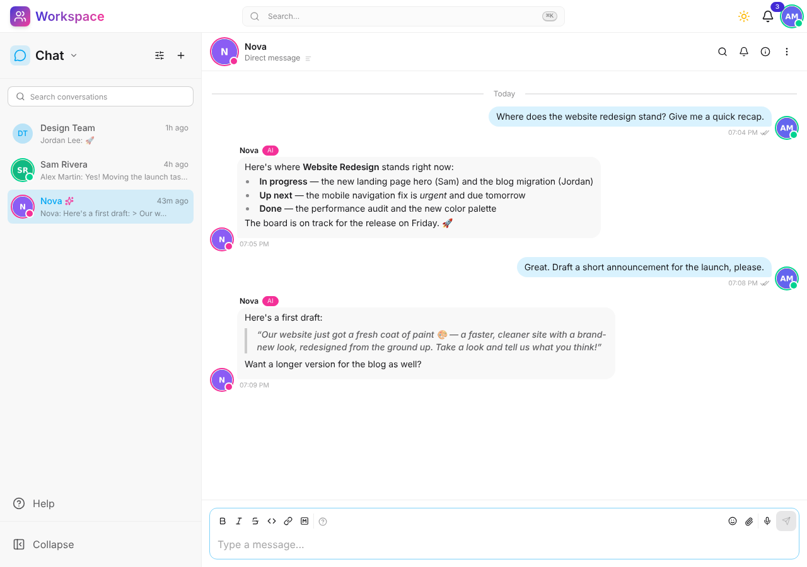
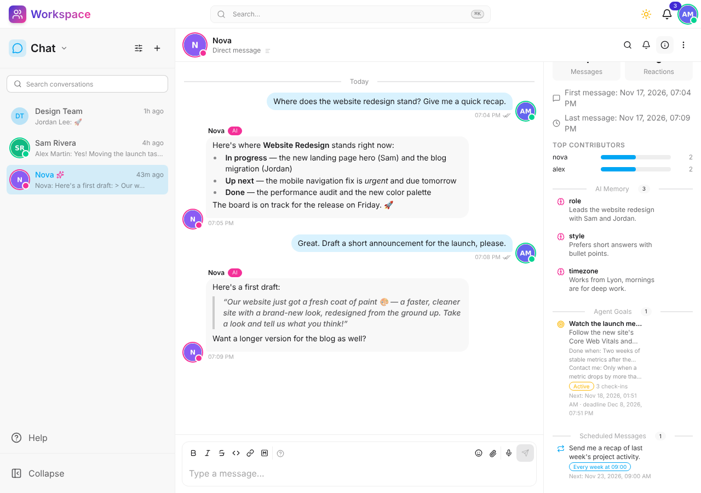

# AI Assistants

AI assistants are bots you talk to in [Chat](../chat/README.md), backed by
any OpenAI-compatible provider. A bot works with your own rights: it can
search and act on your mail, calendar, files and projects, and it can read
the web, make images, speak, remember things about you and pursue goals
over weeks. The same provider powers the AI features of Mail and of the text
editor. Everything is off until the administrator sets `AI_API_KEY`.

## Talking to a bot

- **Start AI Chat**: the *AI* button in the Chat sidebar lists the bots you
  may use, with their descriptions. A bot conversation is always one person
  and one bot. Bots cannot join a group, because what a bot finds with one
  member's rights would be shown to all the others.
- **Every message gets a reply.** While the bot works, its typing bubble
  says what it is doing (searching the web, reading your calendar,
  generating an image). *Cancel* stops it. A reply that failed has a
  *Retry* button. Reloading the page in the middle of a reply picks it back
  up.
- **Each reply shows how it was made**: a collapsible timeline of the
  reasoning steps and of every tool used, failed ones included. The info
  icon shows the model, the tokens, the time spent and the output speed.
- **Images, videos and voice**: bots with vision see attached images and
  frames of attached videos. Voice messages you send are transcribed when
  the instance has speech recognition.
- **Suggested answers**: when a bot asks a question with a few likely
  answers, it shows them as buttons. Tapping one sends it as your reply.
- **Titles**: the conversation is titled automatically. *Regenerate title*,
  in the conversation menu, tries again.
- **Long conversations** keep their recent messages in full and the rest as
  a running summary, so the bot keeps the context.
- **Clear conversation** deletes every message of a bot conversation, for
  good.

## What a bot can do

A bot only ever sees and changes what you yourself can. Web search, images
and voice exist only when the administrator configured them, and a bot can
have its tools turned off entirely.

| Area | Tools | What for |
|---|---|---|
| Workspace | `search_everything` | Search files, notes, mail, contacts, conversations, events, polls, projects and tasks at once. |
| Mail | `search_emails`, `read_email`, `list_folders`, `list_labels` | Find and read messages. |
| | `draft_email`, `reply_to_email` | Write a message or a threaded reply into your Drafts folder. |
| | `mark_email`, `move_email`, `delete_email`, `label_email` | Triage: star, read, file, trash or label. |
| | `send_email` | Send a message. Off unless the bot may send mail, and always shown to you for confirmation first. |
| Calendar | `list_calendars`, `list_upcoming_events`, `search_events`, `check_availability` | Read your schedule. |
| | `create_event`, `update_event`, `cancel_event`, `respond_to_invitation` | Book, move or cancel events and answer invitations. Cancelling a whole series or one occurrence is always an explicit choice. |
| | `create_poll`, `get_poll_results` | Run a scheduling poll and read its votes. |
| Projects | `list_projects`, `list_my_tasks`, `search_tasks` | See what is on your plate. |
| | `create_task`, `move_task`, `update_task`, `comment_on_task` | Create, move, reassign or reschedule tasks, and comment on them. |
| Files | `search_filenames`, `read_file` | Find files by name and read them: text, PDF, office documents, ebooks, images. |
| Chat | `search_messages`, `read_conversation`, `summarize_conversation` | Find and recap discussions. |
| | `ask_user_question` | Offer suggested answers as buttons. |
| People | `search_users`, `check_user_status`, `list_online_users`, `get_current_user_info` | Find a colleague from part of a name, see who is online, read your profile. |
| Web | `web_search`, `read_webpage` | Search with filters (time range, category, site) and read pages, PDFs and news feeds. Needs SearXNG. |
| Weather | `get_weather` | Current weather anywhere, from Open-Meteo. |
| Images | `generate_image`, `edit_image` | Create a picture, or change the last one in the conversation. Needs an image model. |
| Voice | `send_voice_message` | Reply out loud as a voice message. Needs a speech model. |
| Memory | `save_memory`, `delete_memory` | Remember or forget a fact about you. |
| Schedules | `schedule_message`, `list_schedules`, `cancel_schedule` | Messages sent later or on a schedule. |
| Goals | `create_agent_goal`, `list_agent_goals`, `update_agent_goal`, `complete_agent_goal`, `send_user_message` | Long-running missions. |
| Self | `get_my_avatar` | Look at its own avatar. |

## Memory

A bot remembers facts you tell it (your name, preferences, projects) across
conversations. Each bot keeps its own memories. The *AI Memory* section of
the conversation's info panel lists them, and you can edit or delete each
one there. You can also ask the bot to forget something.

## Scheduled messages

Ask a bot for a reminder or a regular digest ("every Monday at 9, list my
week's meetings"). It sends the message once at a set time, or every so many
hours, days, weeks or months, in your time zone. The *Scheduled Messages*
section of the info panel lists them, and there you can change the
instruction or delete one. Only the person who scheduled a message can change
it.

## Agent goals

An agent goal is a mission that spans days or months: watch a topic, follow
something up, prepare a recurring digest. The bot wakes up on its own to
work on it, keeps its own working notes, decides when to check in next, and
only messages you when it has something worth saying. A goal whose deadline
has passed is closed.

- **Creating one**: ask in the conversation, or turn on *Agent mode* in the
  Start AI Chat dialog and give an objective, an optional deadline and a
  first check-in.
- **Steering it**: the *Agent Goals* section of the info panel pauses,
  resumes or stops a goal. Its edit dialog holds the objective, the
  definition of done, constraints and preferences, when to contact you, the
  next check-in, the deadline and the bot's working notes, which you can
  correct.
- Only the person who created a goal can change it. Each check-in first makes
  sure that person is still active, still in the conversation and still
  allowed to use the bot, and stops otherwise.

## AI in other modules

- **Mail**: summaries, drafting and reply suggestions, automatic labels, and
  events found in emails added to the calendar. Each user turns these on or
  off in the mail preferences. See [Mail](../mail/README.md).
- **Text editor**: the *AI* menu of the Files text and code editor improves,
  explains or summarizes the content, or applies an instruction you type.

## Administration

AI features are disabled until `AI_API_KEY` is set. All work runs in the
Celery worker. Celery beat runs `ai.dispatch_scheduled_messages` and
`ai.dispatch_agent_goals` every minute, and `ai.purge_ai_tasks` daily.
Video frames are only shown to a bot where `ffmpeg` is installed (the
Docker image ships it).

### Privacy

- Everything a bot reads goes to the provider: the conversation, the mail,
  files and events its tools return, and the images. Point `AI_BASE_URL` at a
  provider the users can trust with that, or at a self-hosted model (Ollama,
  LM Studio, vLLM...).
- Every AI run is recorded, with its messages, under *AI tasks* in the Django
  admin, readable by administrators. It is kept for `AI_TASK_RETENTION_DAYS`
  days.
- Web pages are fetched by the server. Addresses on private or internal
  networks are refused, and `SEARXNG_BLOCKED_DOMAINS` blocks more. Weather
  lookups send the place name to Open-Meteo.
- Sending email is off for every bot until an administrator allows it, and
  even then each message is confirmed by the user first.

### Bots

A bot is a user account with a bot profile. Create one with
`python manage.py create_bot <username>` (`--name`, `--prompt`, `--model`,
`--description`, `--public`, `--no-tools`, `--no-vision`, `--can-send-email`),
then finish it under *Bot profiles* in the Django admin:

- **Profile**: system prompt, model (empty uses `AI_MODEL`), description,
  avatar.
- **Capabilities**: tools, vision, and sending mail. Turn tools or vision off
  for a model that does not support them.
- **Voice**: a short recording the speech model clones, with its exact
  transcript.
- **Access**: a bot is private by default. Users can use it when it is
  public, when they created it, or when they are among its allowed users or
  groups. Superusers can use every bot.

### Provider and models

| Variable | Default | Meaning |
|---|---|---|
| `AI_API_KEY` | empty | Provider key. Empty disables AI. |
| `AI_BASE_URL` | OpenAI | Any OpenAI-compatible endpoint. |
| `AI_MODEL` | `gpt-5` | Default model for bots and tools. |
| `AI_SMALL_MODEL` | `AI_MODEL` | Fast model for titles, summaries and mail sorting. |
| `AI_EXTRACT_MODEL` | `AI_MODEL` | Finds events in emails. |
| `AI_READING_MODEL` | `AI_SMALL_MODEL`, then `AI_MODEL` | Reads a fetched page for a question. Needs strict JSON output and long input. |
| `AI_VISION_MODEL` | `AI_MODEL` | Describes images sent to a bot, so older images stay in context. Must be multimodal. |
| `AI_MAX_TOKENS` | `2048` | Most tokens per response. |
| `AI_TIMEOUT` | `300` | Seconds per request. |
| `AI_MAX_RETRIES` | `2` | Retries on timeouts and server errors. |

### How requests reach the provider

Every text request (a bot's reply and its tool loop, titles, summaries, mail
and the editor) is made with [Pydantic AI](https://pydantic.dev/docs/ai/),
which writes each request for the backend it talks to:

- With `AI_BASE_URL` unset the backend is OpenAI, and the reply cap is sent
  as `max_completion_tokens`, the only name its reasoning models (`gpt-5`
  included) accept.
- With `AI_BASE_URL` set the backend is treated as a service that speaks
  OpenAI's protocol and nothing more: the cap is sent as `max_tokens`, the
  one name all of them read (Ollama ignores the other and answers uncapped),
  and a reply's reasoning is not sent back to the model on the next round.
- An image a tool returns reaches the model as an image in a message of its
  own, not inside the tool result, which OpenAI refuses.
- A model has to call tools natively. One that writes its calls out as JSON
  in its answer is not understood.

The Celery worker has to run tasks in processes or threads (the default
`prefork` pool, or `threads`), not `gevent` or `eventlet`: a bot's reply
runs on an event loop of its own.

To check how a bot behaves on your own backend and model, see the
[agent evals](agent-evals.md). Images, speech and transcription keep their
own endpoints, below.

### Limits

| Variable | Default | Meaning |
|---|---|---|
| `AI_CHAT_CONTEXT_SIZE` | `30` | Recent messages kept in full; older ones are summarized. |
| `AI_VISION_MAX_IMAGES` | `8` | Most images a vision bot sees at once. |
| `AI_MAX_TOOL_ROUNDS` | `20` | Tool rounds per reply before the bot must answer. |
| `AI_MAX_IDENTICAL_TOOL_CALLS` | `3` | Times one reply may repeat the same call. |
| `AI_TOOL_CONCURRENCY` | `4` | Reading tools (and image generation) one round runs at once; `1` runs them one by one. Each can use a database connection. |
| `AI_TOOL_RESULT_STORE_MAX_CHARS` | `12000` | Characters of a tool result replayed on the next turn. |
| `AI_TOOL_RESULT_REPLAY_MIN_CHARS` | `1500` | What an older tool result shrinks to. |
| `AI_TOOL_RESULT_TASK_MAX_CHARS` | `2000` | Characters of a tool result kept in the run record. |
| `AI_TASK_RETENTION_DAYS` | `90` | Days run records are kept. |

### Web search

Web tools need a [SearXNG](https://docs.searxng.org/) instance with its JSON
format enabled. The Docker Compose deployment ships one, see
[Web Search](../deployments/docker-compose/README.md#web-search-optional).

| Variable | Default | Meaning |
|---|---|---|
| `SEARXNG_URL` | empty | SearXNG address, e.g. `http://searxng:8080`. Empty removes the web tools. |
| `SEARXNG_BLOCKED_DOMAINS` | empty | Comma-separated domains bots may not fetch. |

### Images

| Variable | Default | Meaning |
|---|---|---|
| `AI_IMAGE_MODEL` | empty | Image model. Empty removes the image tools. |
| `AI_IMAGE_BASE_URL` | `AI_BASE_URL` | Separate endpoint for images. |
| `AI_IMAGE_MAX_ATTEMPTS` | `3` | Calls per image before giving up. |
| `AI_IMAGE_RETRY_DELAY` | `2` | Seconds before the first retry, doubled each time. |
| `AI_IMAGE_FAILURE_BUDGET` | `10` | Failed image calls one reply may spend. |

### Voice

Bots speak through a speech model that clones a reference recording. Each
bot takes its own recording from its profile, or `AI_TTS_VOICE_REF`; a bot
with neither cannot speak. `AI_TTS_BASE_URL` must forward the request body
untouched, since the voice is a recording and not an OpenAI voice name:
point it at the speech server itself rather than at an OpenAI-style proxy.

| Variable | Default | Meaning |
|---|---|---|
| `AI_TTS_MODEL` | empty | Speech model. Empty removes the voice tool. |
| `AI_TTS_BASE_URL` | `AI_BASE_URL` | Speech endpoint. |
| `AI_TTS_VOICE_REF`, `AI_TTS_VOICE_REF_TEXT` | empty | Default recording (WAV) and its exact transcript. |
| `AI_TTS_LANGUAGES` | `french,english,...` (10) | Languages the model accepts, spelled out in English. |
| `AI_TTS_NONVERBAL_TAGS` | empty | Sounds the model performs instead of reading, e.g. `[laughter],[sigh]`. List only tags you have heard work. |
| `AI_TTS_MAX_CHARS` | `700` | Characters per voice message. |
| `AI_TTS_TIMEOUT` | `180` | Seconds per synthesis. |
| `AI_TTS_MAX_ATTEMPTS`, `AI_TTS_RETRY_DELAY` | `3`, `2` | Retries per voice message. |
| `AI_ASR_MODEL` | empty | Recognition model that transcribes voice messages sent to a bot. |
| `AI_ASR_BASE_URL` | `AI_BASE_URL` | Recognition endpoint, often the speech server. |
| `AI_ASR_TIMEOUT` | `120` | Seconds per transcription. |

### Monitoring

AI requests, tokens, tool calls and goal check-ins are exported on
`/metrics`, see [Monitoring](../guides/monitoring.md).

### API

All endpoints are under `/api/v1/ai/`. See the [Swagger UI](/schema/swagger-ui/).
