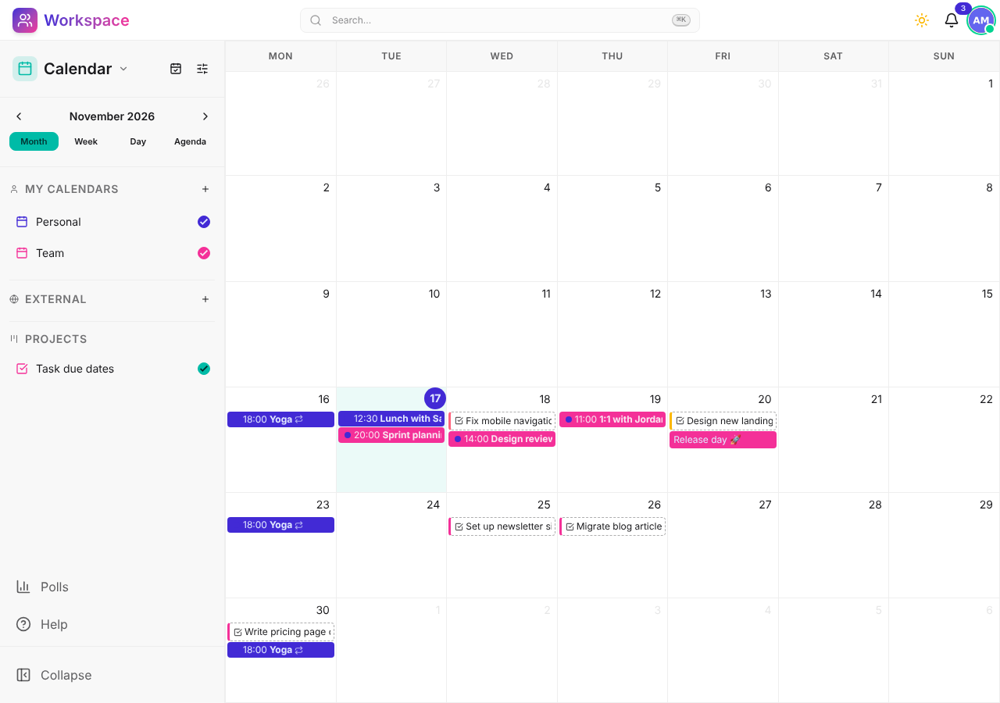
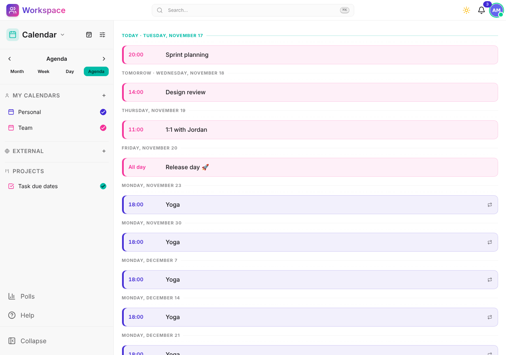
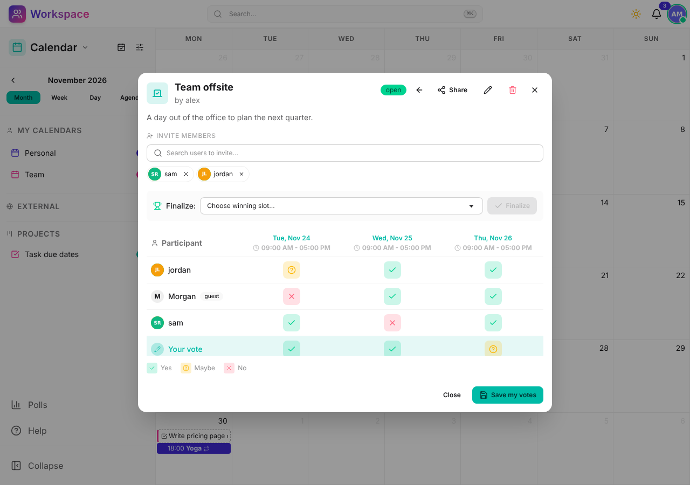

# Calendar

The Calendar module keeps each user's calendars and events, invitations
between users, and scheduling polls to pick a date with people inside or
outside the instance. It syncs both ways with the calendar app of a phone or
computer over CalDAV, and can follow external ICS feeds.

## Views

Month, week, day and agenda views, switched from the sidebar or with
<kbd>M</kbd> <kbd>W</kbd> <kbd>D</kbd> <kbd>A</kbd>; <kbd>T</kbd> goes back
to today, the arrow keys move by period and <kbd>?</kbd> lists every
shortcut. The view, the date and the open event are in the URL, so a link or
a refresh lands on the same screen.

- The **agenda** lists upcoming events day by day and keeps loading as you
  scroll.
- Hovering an event shows a card with its time, place and guests; a click
  opens the detail panel, a right-click a menu (details, copy link, edit,
  delete, accept or decline).
- **Task due dates** from Projects show as light all-day entries, with a
  click through to the task. A switch in the sidebar hides them.
- The **Preferences** set the default view, the first day of the week, 12 or
  24-hour time, week numbers, whether new events start as all-day, and
  whether declined events stay visible.

Dates and times follow the timezone set in each user's settings, not the
browser's. An event keeps the timezone it was created in, so a weekly 10:00
meeting stays at 10:00 across daylight saving changes, and an all-day event
stays on its day for every participant.

## Calendars

Each user starts with a *Personal* calendar and can add more, each with its
own color and a checkbox to show or hide it. The sidebar groups them:

- **My calendars** - the user's own, editable.
- **External** - ICS feeds the user follows (Google Calendar, a sports
  schedule, public holidays). They refresh every 15 minutes, or on *Sync
  now*, and their events are read-only.
- **Other calendars** - calendars of other users the user is subscribed to,
  read-only. Subscriptions are set up by an administrator (see
  [Administration](#administration)).

A calendar's **Edit** dialog can also create a **subscription link**: a
private ICS address any calendar app can follow read-only, without an
account. *New link* replaces it and *Turn off* revokes it.

## Events

Click a day or drag over a time range to create an event, or press
<kbd>N</kbd>. Duration chips (30m, 1h, 2h... 1 week) set the end in one
click.

- **Repeat**: every N days, weeks, months or years, until a date. Editing or
  deleting one occurrence asks for the scope: this event, this and future
  events, or the whole series. A rule set in another app ("every second
  Tuesday", "10 times") is kept as it is and shown read-only.
- **Guests**: the invitee field searches workspace accounts, contacts and
  contact lists of the People module. A contact without an account is added
  as an external guest on their email address; picking a list adds every
  member.
- **Responses**: guests accept or decline from the detail panel or the
  event's menu. Invitations, changes, cancellations and answers each send a
  notification.
- **Invitations by email**: an `.ics` invitation received in a Mail account
  becomes an event in a calendar named after that account. Accepting or
  declining sends the answer back to the organizer from that account, and a
  cancellation from the organizer marks the event cancelled.
- **Morning reminders**: each day at 7:00 in their timezone, every user gets
  a notification for each event they have that day.

Events are found by their title, description or location in the global
search. The AI assistant can read the calendar, book, change or cancel
events, answer invitations and create polls; with mail AI turned on, events
found in emails (a flight, a booking) are added to the account's calendar.

## Scheduling polls

A poll proposes several time slots for one meeting. The **Polls** button in
the sidebar lists the user's own polls and those they are invited to, with a
badge counting the ones still waiting for their vote.

- **Invite** workspace users: they are notified and vote from the calendar.
- **Share** a link for anyone else: a guest votes with a name (and
  optionally an email), without an account, and finds their votes again when
  they come back to the page.
- Each slot takes *Yes*, *Maybe* or *No*, and the grid counts the yes votes
  per slot. The creator is notified of new votes unless *Poll vote
  notifications* is off in the Preferences.
- **Finalize** picks the winning slot: the event is created in the creator's
  calendar, with the users who answered yes or maybe as guests, and every
  invitee is told the date.

## Sync with your devices

Calendars sync both ways with any CalDAV app: Calendar on iPhone, iPad and
Mac, DAVx5 on Android, Thunderbird. The server address is the instance's
`/caldav/` URL (also found from `/.well-known/caldav`), with the user's
username and password, or an API token (*Settings > API Tokens*) for an
account that signs in through single sign-on. The help dialog of the
Calendar shows the exact address.

The user's own calendars are writable from the app; external and subscribed
calendars are listed read-only. Events the user is only invited to stay in
the organizer's calendar and do not sync.

## Administration

The Calendar has no setting of its own, but needs the Celery worker and beat
running:

| Job | Schedule |
|---|---|
| External ICS feeds | Every 15 minutes; *Sync now* queues one at once |
| Morning reminders of today's events | Hourly, for the users whose local time is 7:00 |
| Answers to email invitations | Sent by the worker through the user's Mail account |

The worker needs outbound HTTP access to fetch external feeds.

In the Django admin (`/admin/`), the *Calendar* section lists calendars,
events, external calendars (with a badge counting those whose last sync
failed) and polls. Subscribing a user to another user's calendar is done
there too, under *Calendar subscriptions*
(`/admin/calendar/calendarsubscription/`).

`python manage.py calendar_recheck_recurrence` checks that every recurring
event's stored series data matches its rule, and repairs it with `--fix`.

The API (`/api/v1/calendars`, `/api/v1/events`, `/api/v1/calendar/polls`) is
documented in the Swagger UI at `/api/schema/swagger-ui`.
