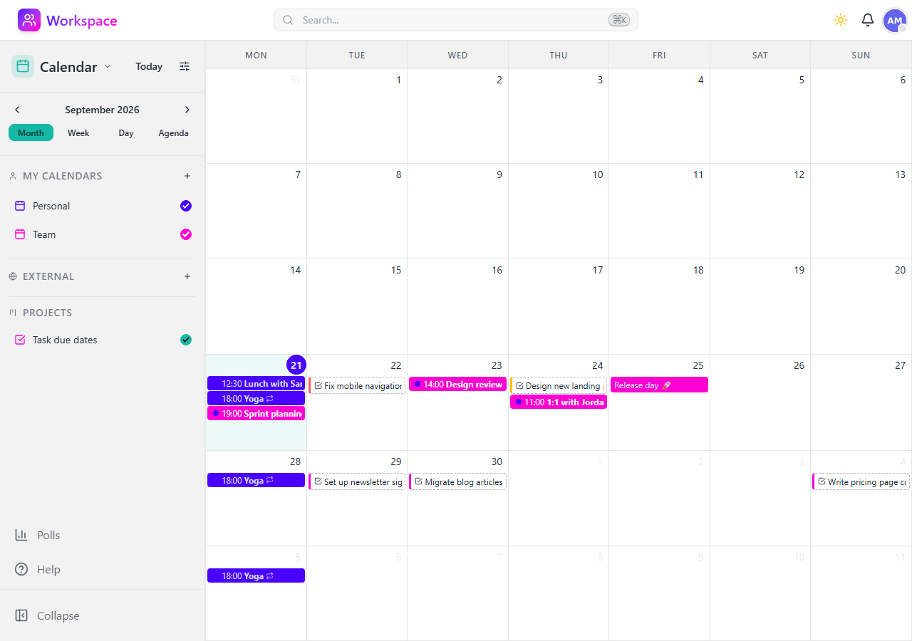
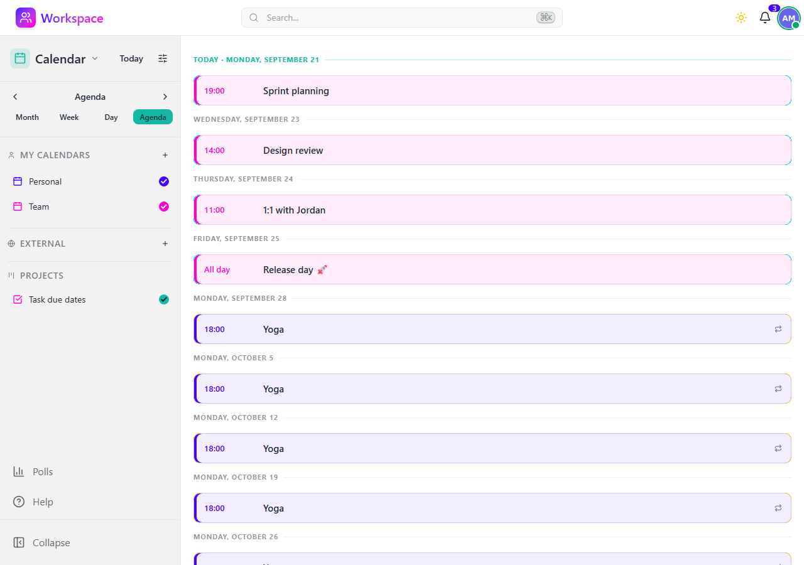

# Calendar

Day, week, month, and agenda views with recurring events, participants, and scheduling polls.

## Features

- **Multiple views** - Month, week, day, and agenda views
- **Multiple calendars** - Create and manage separate calendars with distinct colors
- **Recurring events** - Frequency rules (daily, weekly, monthly, yearly) with exceptions and edit scope (this/all/future occurrences)
- **Participants** - Invite users to events with RSVP support
- **Calendar subscriptions** - Share calendars with other users
- **External calendars** - Subscribe to external ICS feeds (Google Calendar, sports schedules, etc.) with manual or automatic sync
- **Scheduling polls** - Create polls to find the best meeting time, with guest voting support (no account required)
- **Booking pages** - Publish a link where anyone picks a free slot of your real availability; see below
- **iCalendar/iTIP** - Email-based invitations following the iCalendar standard
- **All-day events** - Support for full-day and multi-day events
- **Time zone aware** - Events handled in the correct time zone

## Booking pages

A booking page is a public link (`/calendar/book/<token>`) where anyone, with or
without an account, picks a slot and books it. The appointment lands on the
owner's calendar at once, with the guest as an external attendee, and the owner
is notified. A poll is the opposite flow: the organiser picks the candidate
slots and waits for votes.

The owner states the rules once, from **Booking pages** in the calendar sidebar:

- **Duration** of an appointment, and a **break** kept free around it.
- **Weekly hours**: one or more time ranges per weekday, written on the wall
  clock of the page's time zone, so 9:00 stays 9:00 across a DST change.
- **Minimum notice** and how many **days ahead** bookings are open.
- **Calendars checked for conflicts**. Any event on them, all-day ones
  included, makes the time unavailable, as do the invitations the owner has
  not declined and the appointments of their other booking pages. There is no
  separate blackout list: an all-day "Off" event on one of these calendars is
  how a day is closed.

The free slots are computed on each request from these rules and the owner's
events; the visitor only ever sees instants, never what makes a slot busy.

**Confirmation and cancellation.** The instance has no mail server of its own,
so mail goes out from one of the owner's mail accounts, chosen on the page.
With one, the guest receives a confirmation with an iCalendar invitation and a
cancellation link, then a cancellation that removes the event from their
calendar. Without one, the confirmation screen is the confirmation: it shows
the cancellation link and offers the appointment as a `.ics` download. The
booking page and its mails are in the owner's language, the times in the
visitor's time zone.

**Managing appointments.** A booked appointment is an ordinary event: deleting
it, from the calendar or a CalDAV client, cancels the booking and mails the
guest; moving it moves the booking. The guest cancels from their link until
the appointment starts.

Two guests on the same slot cannot both get it: bookings of one owner are
serialized and the slot is checked again before it is taken; the loser gets a
`409` and picks another time. The public endpoints are rate limited per IP
(`calendar.booking.slots.ip`, `calendar.booking.write.ip` in
`DEFAULT_THROTTLE_RATES`).

## API

Endpoints live at `/api/v1/calendars`, `/api/v1/events`, `/api/v1/external-calendars`, `/api/v1/polls`, `/api/v1/booking-pages` and `/api/v1/bookings` - see the [Swagger UI](/schema/swagger-ui/) for full documentation.
