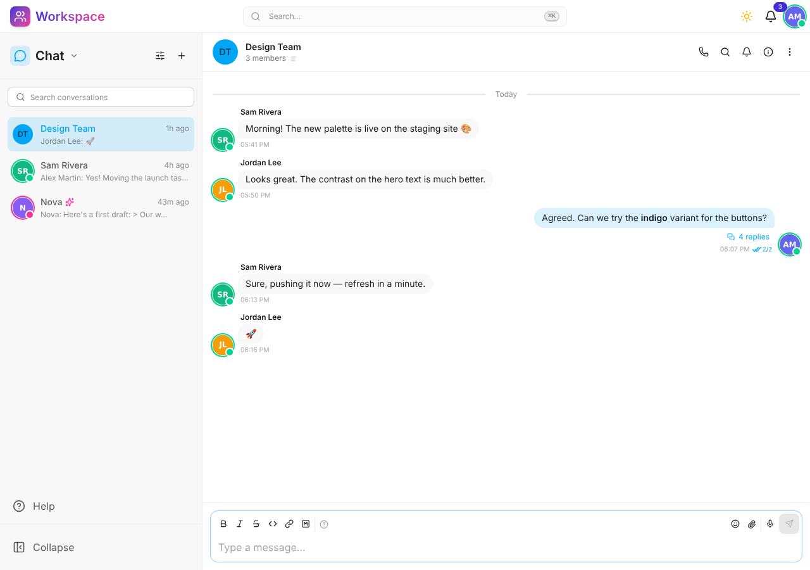
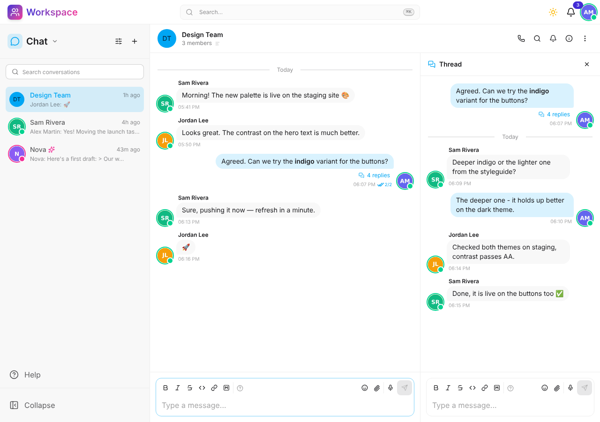

# Chat

The Chat module is for direct and group conversations, with messages
delivered live. It also has threads, voice messages and audio and video calls.
Conversations with an AI assistant take place here as well: see
[AI Assistants](../ai/README.md).



## Conversations

- **New conversation** (`Alt+N`): pick one person for a direct message, or
  several people and a name for a group. The *Groups* tab starts a
  conversation with one or more user groups instead. Its members then follow
  those groups, joining and leaving the conversation as people join and leave
  the groups.
- **The list** holds direct messages and groups together, most recent first,
  with unread badges and a filter box. Pinned conversations stay on top and
  can be dragged into any order.
- **Group admins**: the creator is the first admin. Only admins add and
  remove members, rename the group, change its description or picture, and
  make other members admins. When the last admin leaves, the oldest member
  takes over.
- **The conversation menu** (right-click in the list, or the button in the
  header on a phone) can rename, add members, copy a link, pin, leave and
  open the info panel.
- **The info panel** (`Alt+I`) shows the members, the description, some
  statistics (message counts, top contributors, reactions), the shared media
  and files, and the pinned messages.

A conversation that every person has left is deleted with its messages and
files.

## Messages

- **The message box shows formatting as you type**: bold, italic, code,
  strikethrough, lists and links, from the toolbar or the usual shortcuts.
  One click switches to plain Markdown, and the choice is remembered. Code
  blocks get syntax highlighting. `Shift+Enter` starts a new line.
- **Drafts** are kept per conversation in the browser.
- **@mentions** suggest members as you type and notify the person mentioned.
  In a group, `@everyone` notifies all members.
- **Reactions**: the hover bar offers the six emoji you used most over the
  last month, and the emoji picker has the rest.
- **Right-click a message** to Reply, Add reaction, Copy text or Pin it. On
  your own messages you can also Edit and Delete. `↑` in an empty box edits
  your last message. A deleted message is gone for good, with its images,
  files and voice notes.
- **Read receipts** show who read a message and when. A typing indicator and
  presence rings show who is around.
- **Link previews** show a card for the URLs in a message.
- **Preferences** (in the sidebar) cover a compact conversation list, a
  compact message view and the animation for new messages (Slide, Pop, Fade,
  Bounce or None).

## Threads



Replying to a message opens the discussion in a side panel instead of the
main conversation. The original message shows how many replies it has.
Only the people who took part in a thread see it as unread, so a long side
discussion does not mark the conversation unread for everyone else. The
preference *Show thread replies in the conversation* puts replies back in
the main flow, as quoted replies.

## Attachments and voice messages

- **Attach** files from your computer, or pick them from Files without
  uploading them again. Files picked this way are copied, so deleting the
  original later does not affect the message.
- Several photos or videos display as a mosaic. The viewer browses all of
  the conversation's media with previous and next. *Save to Files* copies an
  attachment into your files.
- **Voice messages**: the microphone button records up to 5 minutes, and the
  message plays inline with its own player.

## Search

- `Ctrl+F` searches the open conversation. You can filter by sender, by
  date (today, the last 7 or 30 days, or a custom range), and by messages
  with files or images.
- The global search (`Ctrl+K`) finds messages too, labelled with their
  conversation.

## Notifications

The bell in the conversation header sets your notification level for that
conversation: *All messages*, *Mentions only* or *Nothing*. A muted
conversation still shows its new messages when you open it. Notifications
also reach your phone as push notifications when the instance has Web Push
set up (see [Notifications](../notifications/README.md)).

## Calls

- **Starting a call**: any member of a direct message or a group can start
  an audio call. Other members see a *Call in progress* banner and can join
  at any time. The call ends when the last person hangs up. Calls are not
  available in conversations with a bot.
- **The voice room** opens in its own window, so pop-ups must be allowed.
  It stays connected while you use the rest of the app. In the room you can
  mute, turn your camera on, share your screen, put one participant in the
  spotlight, and keep chatting. A call that drops after a network change
  reconnects by itself.
- The conversation history records when each call started and how long it
  lasted. Sound cues on join, leave and mute can be turned off in the
  preferences.
- **Test call connection**, in the preferences, checks your microphone, the
  network path and a full loopback through the server. It does not start a
  real call. The *Connection diagnostic* button in the room runs the same
  check during a call. Run it in a single tab: a second tab open on the app
  can intercept the test.

## Administration

### Background work

The Celery worker fetches link previews. Celery beat runs two chat tasks:

- `chat.end_stale_calls`, every minute, ends calls whose participants all
  closed their window without hanging up.
- `chat.purge_orphan_attachments`, daily, deletes attachment files that no
  message uses, and conversations that every person has left. Run it by hand
  with `python manage.py purge_orphan_attachments` (`--dry-run` to preview).

`python manage.py rerender_messages` rebuilds the HTML of every stored
message, for example after a Markdown rendering change.

Link previews are fetched by the server. Addresses on private or internal
networks are refused.

### Calls

Call audio and video travel directly between the participants' browsers,
one connection per pair of participants. The server only relays the setup
messages. Out of the box the browsers find each other through Google's
public STUN server. Users behind strict NATs or firewalls need a TURN
server, and a TURN server also avoids contacting Google.

| Variable | Default | Meaning |
|---|---|---|
| `CHAT_CALL_ICE_SERVERS` | `stun:stun.l.google.com:19302` | Comma-separated STUN and TURN URLs. |
| `CHAT_CALL_TURN_USERNAME` | empty | Username added to every `turn:` and `turns:` URL. |
| `CHAT_CALL_TURN_CREDENTIAL` | empty | Credential added to every `turn:` and `turns:` URL. |
| `CHAT_CALL_MAX_PARTICIPANTS` | `6` | Most people in one call. Each participant sends their stream to every other one, so keep it low. |
| `CHAT_CALL_PRESENCE_TTL` | `12` | Seconds before a participant who stopped responding is dropped from the call. |

```bash
CHAT_CALL_ICE_SERVERS=stun:stun.l.google.com:19302,turn:turn.example.com:3478
CHAT_CALL_TURN_USERNAME=workspace
CHAT_CALL_TURN_CREDENTIAL=...
```

### API

All endpoints are under `/api/v1/chat/`. See the [Swagger UI](/api/schema/swagger-ui).
