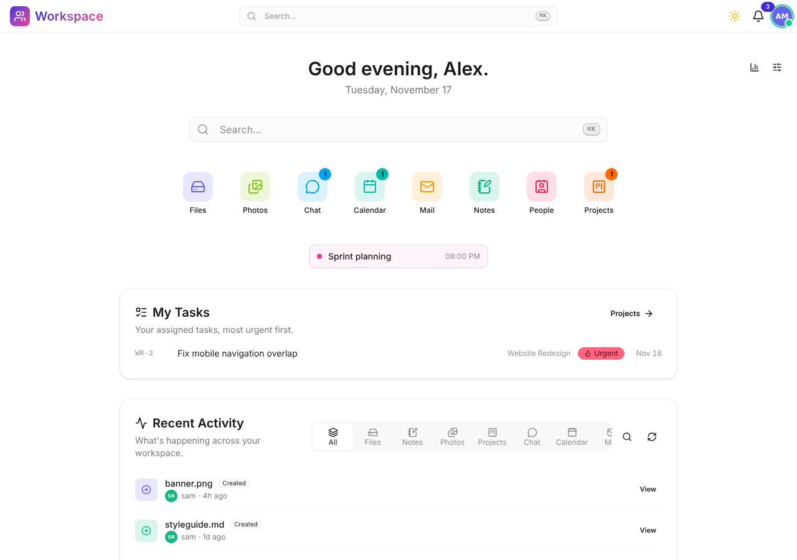

# Dashboard

The home page (`/`) is where a user lands after signing in: a greeting, a
search box over the whole workspace, a tile per app with what is waiting
there, and the day ahead.

## At a glance

- **Greeting and date**, by the hour of the user's own time zone. When the
  browser shares its location, the current weather follows the date; the
  browser asks [Open-Meteo](https://open-meteo.com/) directly, nothing goes
  through the server.
- **Search**: the same search as the top bar's command palette (`Ctrl+K` /
  `Cmd+K`), with its quick actions.
- **App tiles**: one per app the user can open, with the number of unread
  notifications from it. The count goes down as items are dealt with and
  updates live. A tile with a single pending item opens it directly - the
  unread conversation, the overdue task - and the app's home otherwise.
- **Today's events**: what is still ahead today in the user's calendars.
- **My Tasks**: the five most urgent open tasks assigned to the user, overdue
  first, then by due date and priority. Each row opens the task.
- **Recent Activity**: what other people did across the workspace, by app,
  with a search and a refresh button. It only lists apps the user has access
  to.
- **Usage**: a popover with the user's storage against their quota and their
  counts of files, messages, mail and events.

## Preferences

The gear in the top right corner holds the dashboard's own settings:

- show or hide today's events, and the "No upcoming events today." line when
  there are none;
- show or hide My Tasks;
- which apps have a tile. A hidden app is only left off the dashboard: it
  stays in the navigation bar, the search and its links.
