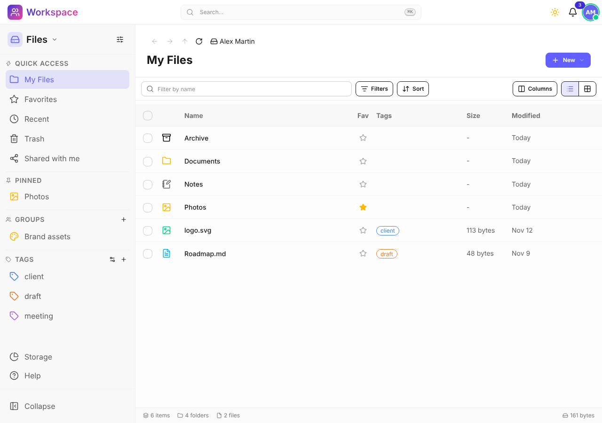
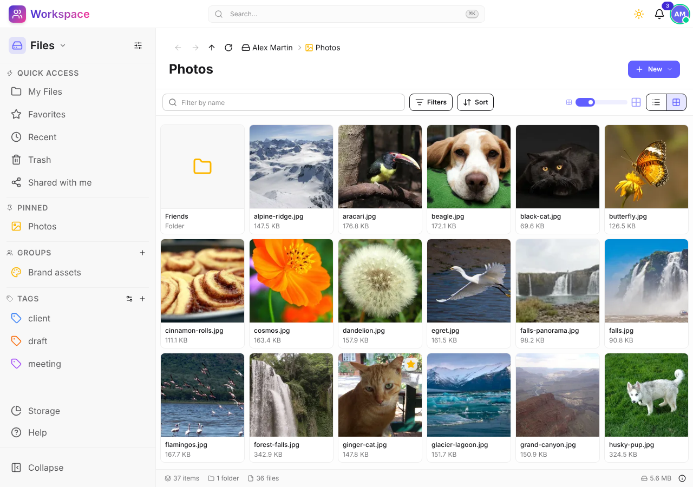
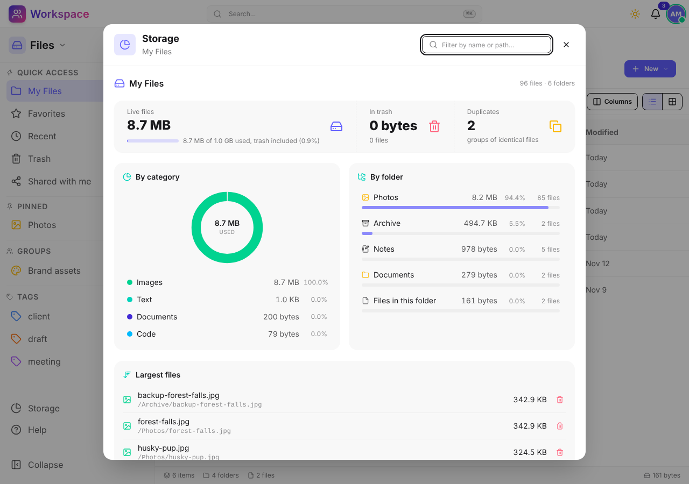

# Files

The Files module is the file manager of Workspace: folders, uploads, viewers
and editors for most file types, sharing with people and by link, group
folders, and WebDAV access. Notes and Photos are built on it: a note or a
photo is a file here.



## Browsing

The sidebar holds *My Files*, *Favorites*, *Recent*, *Trash* and *Shared with
me*, then pinned folders, group folders, favourite tags and the *Storage*
view.

- **List and mosaic views**, the mosaic with an adjustable tile size, and a
  compact list in the Preferences. The toolbar filters the open folder by
  name, type, tag or favorites, and sorts it.
- **Drag and drop**: drop files anywhere on the page to upload them, or drag
  items onto a folder, a breadcrumb or a sidebar entry to move them. *Upload
  Folder* in the *New* menu keeps the folder structure.
- **Right-click menu** on any item or selection: open, download (a folder or
  a selection downloads as a ZIP), rename, cut, copy, paste, share, create a
  shortcut, tags, favorite, pin to the sidebar, extract a ZIP archive,
  properties, delete. The menu only offers what the user is allowed to do.
- **Name clashes** on an upload, a copy or a move ask *Replace*, *Keep both* or
  *Skip*, once for all the remaining ones if wanted; the Preferences can make
  the choice for good.
- **Shortcuts** to a file or a folder can be filed anywhere, for example to
  keep something shared with you in one of your folders. A shortcut follows its
  target when it is renamed or moved.
- **Long operations** - moving, copying, trashing or restoring many files -
  run in the background, with their progress in the *Operations* panel. A file
  that cannot go through is reported with its reason while the rest carries on.
- **Trash**: deleted items stay restorable, and can still be opened to check
  them, until they are purged after 30 days (set by the administrator).
- **Keyboard**: Enter to open, F2 to rename, Del to delete, F to favorite, P
  to pin, Ctrl+X / C / V, Ctrl+I for the properties, Alt+arrows to go back,
  forward or up. The *Help* entry of the sidebar lists them.



## Uploads

Several files upload at once, in a panel that shows each file's progress and
can pause the queue, cancel or retry a file, and settle duplicates in bulk.

- **Resumable**: a file of 50 MB or more is sent in 16 MB chunks. An upload
  cut by the network, a laptop going to sleep or a phone locking its screen
  picks up from where it stopped; its *Retry* button resumes it if the waits
  run out. Chunks also get through a reverse proxy that caps request bodies
  (Cloudflare's 100 MB on its free plan).
- **From other apps**: on Android and Windows, the installed app appears in
  the system share menu. Files shared from another app land in a folder the
  user picks.

## Viewing and editing

A file opens in place of the listing, with the folder path above it and
arrows (or a swipe) to the previous and next file.

| Type | What the viewer does |
|---|---|
| Images | Zoom, slideshow. HEIC and camera RAW photos are decoded in the browser. **Crop & rotate** never rewrites the file and can be reverted at any time. **AI Edit** when the instance has an image model ([AI](../ai/README.md)). |
| PDF | The browser's own PDF viewer. |
| Markdown | Rendered and editable in a WYSIWYG editor. |
| Text and code | Editable with syntax highlighting. Files over 5 MB open as raw text in a new tab. |
| Video and audio | Streamed, with seeking. |
| E-books | EPUB, MOBI, AZW3, FB2 and CBZ open in a reader with a table of contents and adjustable text size. |
| Office documents | Word, Excel, PowerPoint and OpenDocument files open, and save, in an office editor when the instance has one (see [Office editor](#office-editor)). Otherwise they are download-only. |

Anything else can be downloaded. An editor locks the file while it is open,
so two people cannot overwrite each other, over WebDAV included.

Image and video thumbnails are drawn right after the upload. A photo or video
marked as sensitive (from its menu, or by
[Photos' detection](../photos/README.md#sensitive-photos)) is blurred in the
listing and opened behind a cover.

## Properties

The properties panel (*Properties*, or Ctrl+I) shows a file's size, dates,
location and tags, who it is shared with and its public links, a comment
thread, and an activity timeline: who created, renamed, moved or shared it.
PDFs and office documents add their title, author, subject, keywords, page
count and authoring dates; audio and video files their length, codecs and
dimensions.

## Search and tags

- The global search finds files by name and, for text formats, PDFs and office
  documents, by what is written inside them and by the title and author they
  declare. A scanned PDF with no text stays findable by its title.
- **Tags** are personal and coloured, the same ones as in Notes. Favourite
  tags sit in the sidebar; the tag manager renames, recolours, merges and
  deletes them, and purges the unused ones.

## Sharing

- **With people and groups**: a file can be shared read-only or read & write.
  A group share follows the group's membership: someone who joins sees the
  file, someone who leaves loses it. Shared files appear under *Shared with
  me*.
- **Public links** on a file or a folder, with an optional password (one is
  generated and shown in clear) and expiry. A folder link is *Read only*,
  *Upload only* (visitors drop files without an account and without seeing
  what is there) or *Read and upload*, with a per-file size cap and a maximum
  number of uploads. The owner is notified once per batch of uploads.
- **Group folders** are shared spaces, one per group, created by any member
  from the sidebar. Their files count against the group's quota, not the
  members'.

## Storage

*Storage* in the sidebar, or *Analyze storage* on a folder, breaks usage down
by file type and by sub-folder, lists the largest files, and groups duplicates
by content, ranked by the space they waste. At the top of the tree it also
shows the quota and what the trash holds.



## WebDAV

A user's files are reachable at `https://<your-domain>/dav/`, to mount as a
network drive (Windows Explorer, macOS Finder, davfs2, GNOME Files) or sync
from a mobile app. Sign in with the username and password; an account that
uses single sign-on enters an API token (*Settings > API Tokens*) as the
password. The *Help* entry of the sidebar has the steps per system.

The address opens on three folders, named the same in every language:

| Folder | Holds |
|---|---|
| `My Files` | The user's own files and folders. |
| `Groups` | One folder per group the user belongs to. |
| `Shared` | The files other people shared with the user, in one flat list. A read-write share can be saved in place; nothing is created, renamed or deleted there. When two shared files carry the same name, each shows its owner and an id of its own, `report (alice 1a2b3c4d).pdf`, an address that stays that file's whatever else is shared or no longer shared. A file whose own name already ends that way is always shown with its owner and id too. |

A sync app pointed at one folder takes its full address, for instance
`https://<your-domain>/dav/My%20Files/Documents/`.

## Administration

Files needs the Celery worker and beat: thumbnails, text extraction, document
and media properties, malware scans and batch operations run there, never in
the web process. An hourly catch-up (`FILES_CATCH_UP_INTERVAL`) processes
whatever the upload path missed, 20,000 files per pass; to queue a whole
backlog at once:

```bash
python manage.py catch_up search_index documents media_info thumbnails malware_scan
python manage.py catch_up malware_scan --reanalyze   # everything again
python manage.py catch_up malware_scan --dry-run     # count only
```

Video thumbnails and audio and video properties need `ffmpeg` and `ffprobe`
(the Docker image ships them). A file a processor fails on three times is
parked: **Files > Processing failures** in the Django admin lists them, with
a *Retry* action.

| Setting | Default | Meaning |
|---|---|---|
| `STORAGE_QUOTA_BYTES` | 1 GB | Personal quota of a user without a quota of their own. |
| `TRASH_RETENTION_DAYS` | `30` | Days before trashed items are purged (nightly, or `purge_trash`). |
| `RECENT_FILES_LIMIT`, `RECENT_FILES_MAX_LIMIT` | `25`, `200` | Items in the *Recent* view, by default and at most. |
| `FILES_TEXT_VIEWER_MAX_BYTES` | 5 MB | Larger text files open raw in a new tab. |
| `FILES_EBOOK_READER_MAX_BYTES` | 256 MB | Larger e-books are download-only. |
| `FILES_EXTRACT_MAX_BYTES`, `FILES_EXTRACT_MAX_ENTRIES` | 2 GB, `10000` | Limits on what a ZIP extraction writes. |
| `FILES_DROP_MAX_FILE_BYTES`, `FILES_DROP_MAX_FILE_COUNT` | 100 MB, `100` | Ceilings for upload links; a link can only lower them. |
| `FILES_DROP_UPLOAD_RATE_TOKEN`, `FILES_DROP_UPLOAD_RATE_IP` | `20/min`, `60/min` | Anonymous uploads allowed per link and per client. |
| `FILES_DROP_NOTIFY_WINDOW_SECONDS` | `60` | Uploads to a link within this window make one notification. |
| `FILE_UPLOAD_TEMP_DIR` | `MEDIA_ROOT/tmp/uploads` | Where uploads and resumable chunks are spooled. Must be shared by every web replica. |
| `FILES_SYNC_INTERVAL` | `1800` | Seconds between scans for files changed on the disk outside the app (local storage only). |
| `FILES_CATCH_UP_INTERVAL` | `3600` | Seconds between catch-up passes. |

### Storage and quotas

Blobs live under `MEDIA_ROOT` by default, laid out as the users see their
tree, or in an S3-compatible bucket: see
[Object storage](../deployments/README.md#object-storage-s3-compatible),
which also covers `copy_blobs` and `verify_file_storage`. On local storage,
files copied into a user's folder on the server are picked up by the periodic
sync, by the *Sync and refresh folder* button, or by
`python manage.py sync_files [--user alice] [--dry-run]`.

Quotas are set per user and per group in the Django admin (**User storage
quotas**, **Group storage quotas**; an empty value means unlimited). A group
has no limit until one is set. Trashed files count, and every upload, copy,
note or WebDAV write is checked. `python manage.py
storage_quota_report --over` lists the users and groups over their quota.
A resumable upload counts against the quota from the moment it starts; one left
untouched for a day is deleted with the chunks it received.

### Opening files in a tab

A file is served from Workspace's own address. So that an uploaded page
cannot run as part of the app, HTML, SVG and XML files download instead of
opening in a tab (the viewers still preview them), and every other type opens
in a sandbox that runs no script, except PDF, video and audio. A reverse proxy
must leave the `Content-Security-Policy` and `X-Frame-Options` of these
responses untouched: replacing the first lifts the sandbox, and `DENY` in the
second blanks the PDF viewer.

### Office editor

Office documents open in any WOPI editor deployed next to the app:
[Collabora CODE](https://www.collaboraonline.com/code/) (free, the one in the
deployment examples), Collabora Online, [OnlyOffice Docs](https://www.onlyoffice.com/)
in WOPI mode (6.4 or later), or Office Online Server. Every format the editor
advertises becomes viewable, and editable where it can save it. Permissions
are checked on every round-trip, so a revoked share ends the editing session;
a save is an ordinary write (thumbnail, search index, malware scan), and an
editing session locks the file. If the editor is unreachable, the viewer
offers the download.

| Setting | Default | Meaning |
|---|---|---|
| `WOPI_DISCOVERY_URL` | empty | The editor's `/hosting/discovery` URL. Empty: office files are download-only. |
| `WOPI_HOST_URL` | from the request | Workspace's address as the editor reaches it (e.g. `http://web:8000`). |
| `WOPI_TOKEN_TTL` | `36000` | Seconds an editing session's access token lasts. |

The browser loads the editor from its own hostname, so it needs a public
route too. Setup: [Docker Compose](../deployments/docker-compose/README.md#office-documents-optional),
[Kubernetes](../deployments/kubernetes/README.md#office-documents-optional).

### Malware scanning

Uploads can be scanned by a [ClamAV](https://www.clamav.net/) daemon, after
the upload response so it never slows one down. Every write path is covered:
the web app, WebDAV, the office editor, archive extraction and imports. It is
off by default.

| Setting | Default | Meaning |
|---|---|---|
| `FILES_MALWARE_SCAN_ENABLED` | off | Scan uploaded content. |
| `FILES_CLAMAV_SOCKET` | empty | `clamd` socket (`unix:///var/run/clamav/clamd.ctl`); wins over host and port. |
| `FILES_CLAMAV_HOST`, `FILES_CLAMAV_PORT` | `127.0.0.1`, `3310` | `clamd` over TCP. |
| `FILES_CLAMAV_TIMEOUT` | `60` | Seconds per scan. |
| `FILES_MALWARE_ON_DETECTION` | `block` | `block` quarantines an infected file; `flag` records the verdict and leaves it usable. |
| `FILES_MALWARE_ON_ERROR` | `open` | A file that could not be scanned stays usable (`open`) or is quarantined (`closed`). |
| `FILES_MALWARE_SCAN_MAX_BYTES` | 25 MB | Larger files are recorded as skipped and stay usable. |

- **Quarantined** files cannot be downloaded, previewed, shared by link,
  found in search, attached to a message, an email or a task, or read by the
  assistant; their owner still sees them, marked. A file whose scan has not
  run yet (normally a few seconds) stays usable.
- **Size cap**: `clamd`'s own `StreamMaxLength` also defaults to 25 MB, and
  the lower of the two wins. To scan larger files, raise both.
- **Monitoring**: the admin dashboard shows the daemon's reachability,
  quarantined files and scanner errors; **Files > Malware scans** in the Django
  admin holds every verdict. Verdicts cannot be deleted, since a file without
  one reads as never scanned, and so readable.
- **Releasing a file**: *Re-scan* queues a fresh scan for a stale verdict (the
  signatures have moved on). *Clear the quarantine* records a false positive,
  with who cleared it and why; it vouches for those exact bytes only, so new
  content is blocked again until scanned. It needs the **Can clear a malware
  quarantine** permission, separate from reading the verdicts.
- **Existing libraries** are scanned by the hourly catch-up, which also
  re-scans a file whose content changed after its verdict.
- **Checking a real engine**: upload the
  [EICAR test file](https://www.eicar.org/download-anti-malware-testfile/) and
  check it is quarantined within seconds.

### API

The REST API lives under `/api/v1/files` and is documented in the Swagger UI
(`/api/schema/swagger-ui`), resumable uploads (`/api/v1/files/uploads`)
included. The WOPI endpoints under `/api/wopi/files/` follow the
[WOPI protocol](https://learn.microsoft.com/en-us/microsoft-365/cloud-storage-partner-program/rest/)
and only accept the editor's access tokens.
