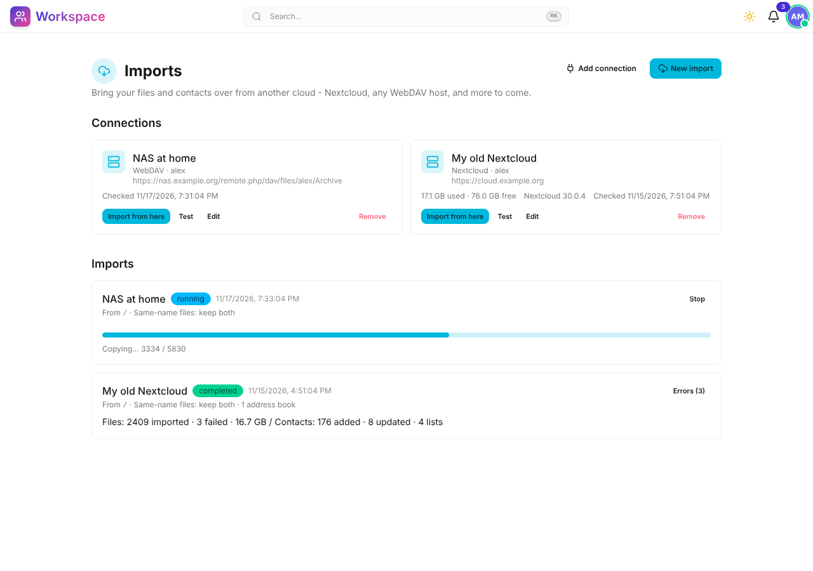

# Imports

The Imports page brings files and contacts over from the cloud a user is
leaving - a Nextcloud account or any WebDAV folder - into Files and People. It
is in preview. Being used once when arriving rather than lived in, it stays off
the dashboard and opens from the user menu or the command palette (*Import
from another cloud*).

## Connections

A connection is a remote account: a provider, a URL, a username and an app
password. It is only saved once the server has answered with those
credentials, and its card then shows the remote's space used and free and,
for Nextcloud, its version. *Test* checks it again, *Edit* changes it.

| Provider | Brings over | Notes |
|---|---|---|
| Nextcloud | Files, with their favorites and tags; contacts | Paste the address of the instance, the rest is derived. Use an app password (Nextcloud *Settings > Security*). |
| WebDAV | Files | Any server: give the full URL of the folder to import from. |

## Starting an import

*New import* walks through four steps: the connection, what to bring over,
where it goes, and a summary before starting.

- **Files**: browse the remote and pick the folder to start from, then the
  destination folder in Files. Everything lands in a folder named after the
  connection unless that box is unticked. A file whose name is already taken
  is kept both ways (renamed), skipped, or replaces the local one.
- **Contacts**: pick the address books to import, and for each one whether it
  goes into the user's own contacts or a group's. Contact groups and categories
  become lists, and pictures come along. A contact already there (same card,
  or same email) is updated rather than duplicated. Nextcloud's own generated
  books (the instance's account directory, recently contacted) are left out.

## Following an import

The import runs in the background: the user can leave the page and gets a
notification when it finishes, fails or is stopped. On the page:

- Live progress, first while the remote is listed and the storage quota
  checked (an import that would not fit is refused before anything is
  copied), then while it copies.
- *Stop* ends a running import; what is already imported stays.
- Entries that could not be imported are listed with their reason, and
  *Retry* runs only those and the ones never reached.
- Running an import again on the same connection only fetches what changed:
  new files, new versions, edited contacts. A connection runs one import at a
  time.

## Administration

Imports run in the Celery worker, in slices so that a migration of several
hours never meets the task time limits, and resume where they stopped after a
restart. Celery beat restarts an import whose worker died (every 10 minutes)
and purges old error reports (nightly).

| Variable | Default | Purpose |
|---|---|---|
| `IMPORTS_BATCH_SECONDS` | `1200` | Length of a slice: a running import yields and queues itself again after this long. |
| `IMPORTS_HTTP_TIMEOUT` | `60` | Seconds per request to the remote. |
| `IMPORTS_MAX_CONSECUTIVE_ERRORS` | `20` | Consecutive remote failures after which an import gives up rather than trying a dead connection entry by entry. |
| `IMPORTS_JOB_RETENTION_DAYS` | `90` | Error reports of imports finished longer ago are purged. What was imported is remembered for good: it keeps later runs incremental. |
| `IMPORTS_ALLOW_PRIVATE_NETWORKS` | off | Allow remotes on private networks (10/8, 172.16/12, 192.168/16, fc00::/7, carrier-grade NAT). |
| `IMPORTS_ALLOWED_HOSTS` | empty | Comma-separated host names trusted as they are, skipping every address check below. |

Connection passwords are stored encrypted with a key derived from
`SECRET_KEY`: changing it makes saved connections unusable until their
password is entered again.

### Remote URL safety

The worker connects to whatever URL a user typed, so every request checks the
address it is about to dial: loopback, link-local (cloud metadata), multicast
and reserved addresses are always refused, private networks unless
`IMPORTS_ALLOW_PRIVATE_NETWORKS` is on. The address checked is the one
connected to, which defeats DNS rebinding. Redirects are never followed and
the `HTTP_PROXY`/`HTTPS_PROXY` variables are ignored. A host in
`IMPORTS_ALLOWED_HOSTS` bypasses all of this: list only servers you would
connect to yourself.

The same guard (`workspace/common/url_guard.py`) covers every other server-side
fetch of a URL a user chose: mail account autodiscovery, external calendar
feeds, the AI assistant's web reading, chat link previews and Web Push
endpoints. Those refuse private networks whatever the two settings above say;
the settings only open them for imports.

The API is documented in the [Swagger UI](/schema/swagger-ui/).
