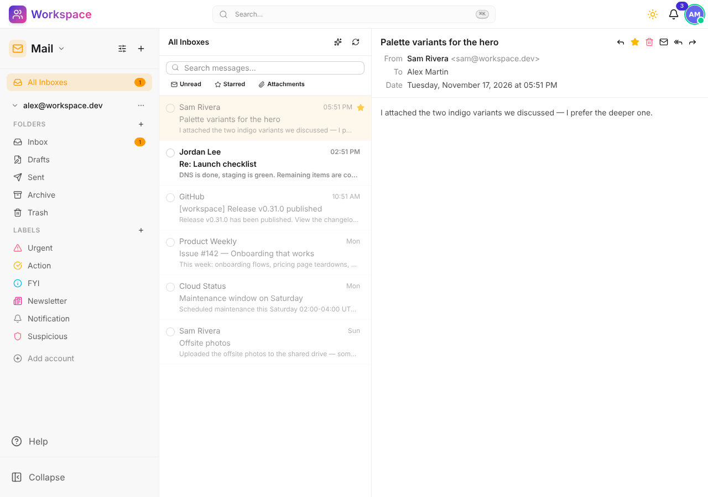
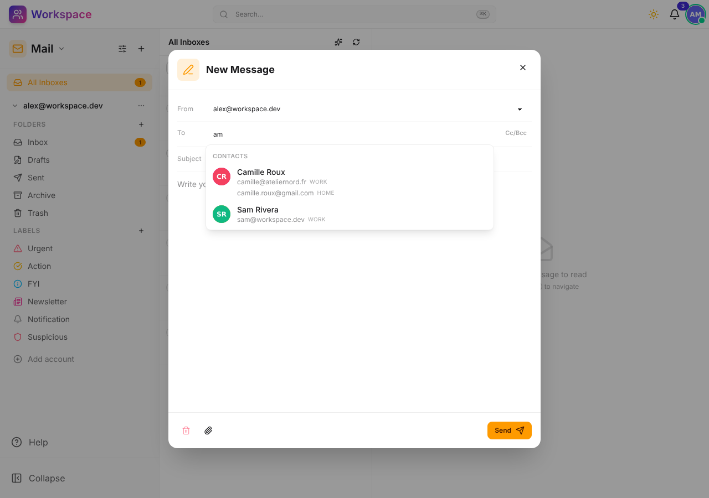

# Mail

The Mail module is an email client for the accounts users already have
elsewhere: Gmail, Microsoft 365 or any IMAP/SMTP server. Mail stays on the
provider's server; Workspace syncs a copy to read, search, sort and answer
it, with optional AI help.

## Accounts

A user can connect several accounts. **Add account** takes an address and a
password; **Detect** fills in the IMAP and SMTP servers when the provider
publishes them. Where the administrator has set it up, **Connect with Google**,
**Connect with Microsoft** or a button for one more provider of their choice
signs in through the provider instead, with no password stored. [Connecting a Google account](google.md) compares the two
for Gmail.

- The **account menu** (right-click the account in the sidebar) syncs it now,
  edits its settings, tests the IMAP and SMTP connections, sets its signature,
  and opens its hidden folders, merged folders and filters.
- The **first sync** fetches the 200 most recent messages of each folder;
  after that, every new message comes in. New mail is checked every 5 minutes
  by default, and the refresh button or *Sync* fetches it at once.
- When a provider revokes Workspace's access, the account is paused and its
  owner gets a notification. Connecting again with the same button resumes it.
- **Remove** deletes Workspace's copy of the account, never the mail on the
  server.

## Reading

Mail opens on **All Inboxes**, the inboxes of every account in one list. The
sidebar lists each account's folders and labels.

- **Search** looks through the open folder or label by subject, sender and
  body, ignoring case and accents, best matches first. The *Unread*, *Starred*
  and *Attachments* filters narrow the list.
- **Select** several messages to mark them read or unread, star, archive,
  report as spam, move or delete them in one go. Dragging messages onto a folder moves them; onto a
  label, applies it.
- In a message, hovering a sender or recipient shows a **contact card**: the
  whole contact when the address is in the user's People address book, an
  *Add to contacts* button when it is not, and *Send email* either way.
- **Attachments** download, or go straight into Files with *Save to Files*.
- **Archive** files a message into the account's Archive folder. An account
  without one gets an *Archive* folder on the server the first time. On Gmail,
  which keeps every message in *All Mail*, archiving takes the message out of
  the Inbox, so it is only offered there.
- **Report spam** moves a message into the account's Spam folder, and **Not
  spam** moves it from there back to the Inbox. The server's own filter learns
  from these moves where it is set up to.
- **Show headers** and **Download .eml** fetch the message from the server as
  it stores it: every header, to see where a suspicious message really came
  from, or the whole original with its attachments, to keep or pass on.
- **Delete** moves the message into the account's Trash, where it can still
  be recovered, in Workspace and from every other client. Deleting it again
  from the Trash, or on an account without a Trash folder, removes it from the
  server for good.
- **Keyboard**: `J`/`K` next and previous, `C` compose, `R` reply, `A` reply
  all, `F` forward, `S` star, `U` read/unread, `E` archive, `!` spam or not
  spam, `#` delete, `?` the full list. `E` and `!` act on the selection when
  no message is open.

The **Preferences** set the list density, the number of preview lines, whether
labels show in the list and whether deleting asks first.

## Writing

- **Recipient suggestions** in To, Cc and Bcc list the user's contacts first,
  each of their addresses on its own line, then workspace accounts, then
  addresses from their mail history. The person icon beside one adds it to
  the address book.
- **Drafts** are saved automatically to the account's Drafts folder and
  restored when the message is reopened.
- **Attachments** are uploaded from the device or picked *From Workspace*
  (copied, so deleting the original later does not break the message).
- Each account has its own **signature**, added to new messages, replies and
  forwards, and swapped when the sender account changes.
- Replies thread properly in the recipients' mail clients, and every sent
  message is filed in the account's Sent folder, Bcc included.

## Folders and labels

**Folders** are the account's IMAP folders: creating, renaming, moving and
deleting one does the same on the server. The folder menu also marks all as
read, sets an icon and a color, turns AI auto-labeling off for that folder,
and hides it from the sidebar (*Hidden folders* in the account menu brings it
back). The Inbox, Sent, Drafts, Trash and other special folders cannot be
renamed, moved, hidden or deleted.

When a provider insists on its own Trash, Sent or Drafts next to the one the
user made, **Merge into...** declares them one folder: it shows all their mail
with the combined counts, receives what the app files, and the alias leaves
the sidebar. Nothing moves on the server, and *Merged folders* undoes it.

**Labels** belong to an account and live in Workspace, not on the mail server.
Each has a name, a color, an icon and an optional one-line description of what
belongs there, which the AI reads when it sorts. Every account starts with
*Urgent*, *Action*, *FYI*, *Newsletter*, *Notification* and *Suspicious*
(phishing, scams and unsolicited mail the provider's filter missed).

## Filters and rules

*Filters & Rules*, in the account menu, holds the account's rules. A rule is a
**When** and a **Then**:

- **Conditions** on the sender, a recipient (To, Cc or either), subject, body,
  folder, attachments, star or date: contains, equals, starts or ends with,
  is in a list, or matches a regular expression. Conditions combine into
  AND/OR groups (up to 5 levels deep and 20 conditions).
- **Actions**: add or remove a label, mark read or unread, star or unstar,
  move to a folder, delete. *Stop processing more rules after this one* ends
  the chain.

Rules run in order on every new message, before the AI sorts it, and each can
be turned off without deleting it. *Apply to a folder* runs a rule on mail
already there (the 500 most recent messages): a preview counts the matches
before anything changes. **Create filter**, in a message's right-click menu,
opens a new rule on its sender. An *Advanced* mode edits a rule as JSON.

## AI features

When the instance has an AI provider configured, three switches in the
Preferences turn each feature on or off for the user. All three start on.

- **Auto-classify new emails** labels incoming mail, Sent and Drafts aside,
  using the label descriptions. The sparkles button above the list sorts the
  open folder on demand.
- **Extract events** reads confirmed events (a flight, an appointment, a
  booking) out of mail threads and adds them to the calendar. Only confident,
  future events are kept; the message shows each one as a *Suggested event*,
  with *View in calendar* and *Remove*.
- **AI writing assistance** adds *Summarize* to a message, and *Compose with
  AI* to the composer: describe the message and it is written into the body,
  from the original message when replying.

Chat assistants can also search and read the user's mail, write a message or
a threaded reply into Drafts for them to review, and star, file, trash or label
what is in the inbox. Sending is off by default: a bot needs the send
capability, and even then it shows the message and waits for the user's
go-ahead before anything leaves. See [AI](../ai/README.md).

## Notifications

*Notify me about*, in the Preferences, picks between every new email, only
the labels the user chose (*Urgent* by default, set per label with *Notify me
about these emails*), or never. The label mode needs auto-classify, and is the
default when it is on. Mail in Sent and Drafts and the first sync of an
account never notify, a burst of arrivals in one folder is capped (10 by
default), and opening the message clears its notification.

## Calendar invitations

An invitation received by mail (an `.ics` attachment) puts the event in the
calendar, and a later update or cancellation from the organizer changes or
removes it. Accepting or declining it from the Calendar answers the organizer
from the same mail account.

## Elsewhere in Workspace

The global search finds messages, and the people the user has exchanged mail
with.

## Administration

Mail needs the Celery **worker** and **beat**: beat starts a sync of every
active account every `MAIL_SYNC_INTERVAL` seconds, and the worker talks to
the IMAP servers, so without beat mail only arrives when a user asks for a
sync. AI features run in the worker too.

| Setting | Default | Meaning |
|---|---|---|
| `MAIL_SYNC_INTERVAL` | `300` | Seconds between two syncs of an account. |
| `MAIL_MAX_ATTACHMENTS_SIZE` | 25 MB | Bytes of attachments one outgoing message may carry. Common SMTP servers refuse 25-50 MB, and encoding adds a third on the wire. |
| `MAIL_ALLOW_PRIVATE_NETWORKS` | off | Allow IMAP and SMTP servers on private networks (10/8, 172.16/12, 192.168/16, fc00::/7, carrier-grade NAT). |
| `MAIL_ALLOWED_HOSTS` | empty | Comma-separated server names trusted as they are, skipping every address check below. |

### OAuth2 sign-in

A **Connect with ...** button appears for each provider whose client ID is
set; signing in needs its secret too. Register Workspace with the provider as
a confidential client, with the redirect URI
`https://<your-domain>/mail/oauth2/callback`; the instance needs a public
HTTPS address for it.

| Setting | Default | Meaning |
|---|---|---|
| `OAUTH_GOOGLE_CLIENT_ID`, `OAUTH_GOOGLE_CLIENT_SECRET` | empty | Google OAuth client (Gmail, Google Workspace). [Connecting a Google account](google.md#option-b-oauth2) walks through the Google side. |
| `OAUTH_MICROSOFT_CLIENT_ID`, `OAUTH_MICROSOFT_CLIENT_SECRET` | empty | Microsoft application (Outlook, Hotmail, Microsoft 365), asked for `IMAP.AccessAsUser.All` and `SMTP.Send` (Office 365 Exchange Online), `offline_access`, `openid` and `email`. |
| `OAUTH_GENERIC_CLIENT_ID`, `OAUTH_GENERIC_CLIENT_SECRET` | empty | One more provider of your choice, configured with the settings below. |
| `OAUTH_GENERIC_NAME` | `Generic` | Name shown on its button (e.g. `Fastmail`). |
| `OAUTH_GENERIC_AUTH_URL` | empty | Authorization endpoint. |
| `OAUTH_GENERIC_TOKEN_URL` | empty | Token endpoint. |
| `OAUTH_GENERIC_USERINFO_URL` | empty | Userinfo endpoint, answering a JSON object with an `email` field for the access token. Optional for an OpenID Connect provider. |
| `OAUTH_GENERIC_SCOPES` | empty | Space-separated scopes: the ones the IMAP and SMTP servers require, plus `openid email` for an OpenID Connect provider. |
| `OAUTH_GENERIC_IMAP_HOST` | empty | IMAP server (port 993, SSL/TLS). |
| `OAUTH_GENERIC_SMTP_HOST` | empty | SMTP server (port 587, STARTTLS). |

The generic provider's account address is read from the userinfo endpoint.
Without one, it is taken from the `email` claim of the OpenID Connect ID token
returned with the tokens, which needs the `openid` and `email` scopes. When
neither gives an address, the sign-in stops with "Could not determine email
address from provider."

### Connection security

Every IMAP and SMTP connection is encrypted before the password or token is
sent. The account's **Security** field picks how: **SSL/TLS** from the first
byte (IMAP 993, SMTP 465), or **STARTTLS** (IMAP 143, SMTP 587), where a
server that does not offer it is refused. There is no unencrypted mode.

The server's certificate is always verified and must match the host name. A
mail server with a self-signed or private-CA certificate is refused until that
authority is trusted: add it to the system store of the web and worker
containers, or point `SSL_CERT_FILE` at a PEM bundle that contains it.

### Server addresses

Mail connects to whatever server a user types, so the address is checked
before each connection: loopback, link-local (cloud metadata), multicast and
reserved addresses are always refused, private networks unless
`MAIL_ALLOW_PRIVATE_NETWORKS` is on. A server listed in `MAIL_ALLOWED_HOSTS`
skips the check: list only servers you would connect to yourself. So do the
servers of the generic OAuth2 provider, which the administrator chose.

An account whose server is refused keeps its messages and stops syncing; its
last sync error says why, and so does **Test connection**.

The address checked is the one connected to, which defeats DNS rebinding.
TLS still runs against the server's name.

### Stored data

- Passwords and OAuth tokens are encrypted with a key derived from
  `SECRET_KEY`. Changing it makes them unreadable: every user then has to
  enter their password again or reconnect.
- Synced messages are kept in the database, their attachments in the blob
  storage under `mail/attachments/`.
- **Detect** reads the provider's autoconfig file from its domain, then from
  Mozilla's database (`autoconfig.thunderbird.net`). It never connects to a
  private address, so a mail server on the local network is entered by hand,
  once the administrator has opened it (see *Server addresses*).

### Monitoring

The admin dashboard counts the active accounts whose last sync failed. The
Django admin's *Mail accounts* list filters accounts by sync health and has a
*Sync now* action.

### AI

AI features need an AI provider (`AI_API_KEY`); `AI_EXTRACT_MODEL` picks the
model for event extraction. See [AI](../ai/README.md).

## API

All endpoints are under `/api/v1/mail/` - see the [Swagger UI](/api/schema/swagger-ui).
