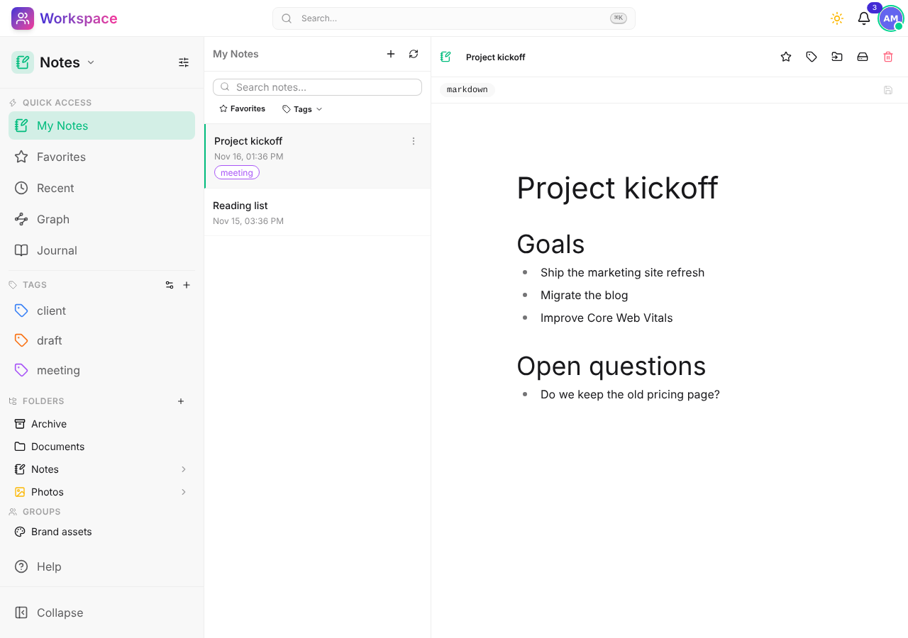
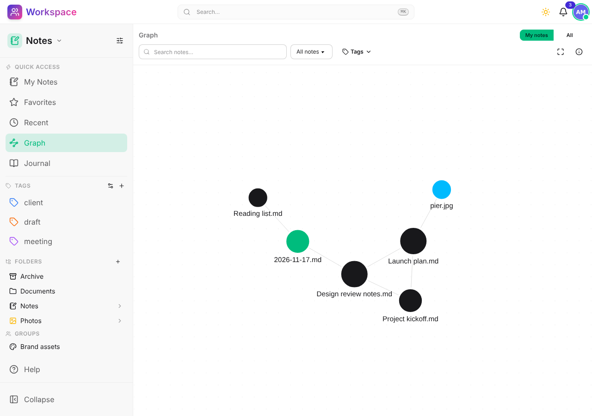

# Notes

The Notes module is a Markdown notebook: folders, tags, a daily journal,
links between notes and a graph of them. Every note is a `.md` file in Files,
so it is also reachable from Files, over WebDAV and in the global search, and
shares, trash and permissions work the same way.

## Layout

The page has three panels: the sidebar, the list of notes, and the editor.

- **Quick Access**: *My Notes* (everything under the Notes folder and its
  subfolders, journal left out), *Favorites*, *Recent* (the notes edited
  last), *Graph* and *Journal*.
- **Tags**: the user's favourite tags. The tag manager, opened from the
  section heading, searches, recolors, renames, merges and deletes tags, the
  same ones Files uses.
- **Folders** and **Groups**: the user's folder tree and the folders of their
  groups, as deep as they go. A group without a folder yet gets one from the
  *+* button. A right-click on a folder creates a subfolder, renames it,
  moves it to the trash with its notes, hides it from the sidebar (*Show
  hidden items* in the Preferences brings it back) or opens it in Files.

The list searches the title and the text of the notes, and narrows to
favourites or to one or more tags. The Preferences set the sort order
(last modified, created, name), a compact one-line list, the default view,
which sidebar sections show, and whether a deletion asks first.

On first visit, a `Notes` folder and a `Journal` folder inside it are
created in the user's files. The Preferences can point either one at another
folder.

## Editor

Notes open in a WYSIWYG Markdown editor: headings, lists, checklists,
tables, code blocks and math, with a `/` menu to insert blocks. The title
above it renames the note; beside it are the favourite star, the tags, *Move
to folder*, *Open in Files* and *Delete*, which sends the note to the trash.

- **Autosave** writes the note two seconds after the last keystroke, or at
  once with <kbd>Ctrl</kbd>+<kbd>S</kbd>, and shows whether it is saved.
- **One writer at a time**: while someone edits a note, it opens read-only
  for the others, with their name in a banner. If a note changed on the
  server while the user was away, their edit is refused rather than written
  over it, and a banner asks them to reload.
- **Links**: typing `[[` searches the notes and inserts a link to the one
  picked. Hovering a link shows the linked note's title, tags and first
  line.
- **Embedded files**: typing `![[`, or dragging a file from the note list or
  from Files onto the editor, embeds a file: images, videos and audio show as
  a preview, any other file as a card. A click opens it in a viewer over the
  note. The note points at the file rather than copying it, so it always
  shows its current version, and a reader who cannot open the file sees a
  placeholder.

The same editor opens Markdown files in Files, links and embeds included.

## Journal

*Journal* opens today's note, named after the date (`2026-11-17.md`) in the
user's own timezone, and creates it the first time. Earlier days are listed
below it, newest first. Journal notes cannot be renamed, so each day keeps
its note. The command palette's *Today's journal* and <kbd>G</kbd>
<kbd>J</kbd> go straight to it.

## Graph

The graph draws every note as a node and every link between two notes as an
edge, with the files they embed alongside. Unlinked notes stay visible.

- Switch between *My notes* and every note the user can see, keep only
  favourites, journal entries or regular notes, or filter by tag.
- The search box highlights matching notes, and the colors tell favourites,
  journal entries, notes and embedded files apart.
- Hovering a node shows the same card as a link; a click opens the note.

## Shortcuts

<kbd>N</kbd> new note, <kbd>J</kbd>/<kbd>K</kbd> next and previous note,
<kbd>R</kbd> rename, <kbd>S</kbd> star, <kbd>#</kbd> delete, <kbd>G</kbd>
then <kbd>A</kbd>/<kbd>F</kbd>/<kbd>R</kbd>/<kbd>J</kbd> for My Notes,
Favorites, Recent and Journal, <kbd>?</kbd> for the help. The command
palette also offers *New note*, *Favorite notes* and *Recent notes*. On a
phone, a floating button creates a note.

Notes have no API of their own: they are files, served by `/api/v1/files`
(see the Swagger UI at `/schema/swagger-ui/`).
