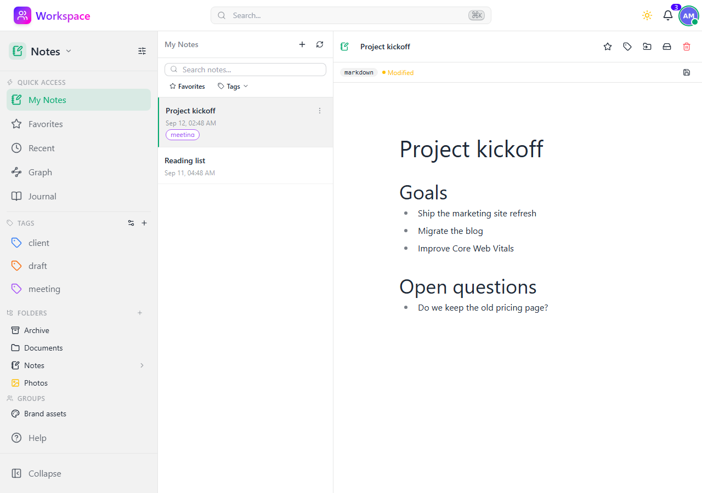

# Notes

A Markdown-based note-taking module with journal mode, folders, tags, and full-text search.

## Features

- **Markdown editor** - Write notes in Markdown with live preview
- **Three-panel layout** - Sidebar, note list, and editor for quick navigation
- **Journal mode** - Dedicated journal folder with date-based entries
- **Folders** - Organize notes in a personal folder hierarchy
- **Group folders** - Shared note spaces for team collaboration
- **Tags** - Tag notes for cross-folder organization
- **Favorites** - Star notes for quick access
- **Recent** - Track recently opened notes
- **Embedded files** - Show an image, PDF, audio or video file from Files inside a note with `![[` or by dragging it from the note list or the Files listing; other files appear as a card linking to them. An embed points at the file rather than copying it, so the note always shows its current version, and a reader who cannot open the file sees a placeholder instead
- **Search** - Full-text search across note titles and note contents
- **Quick Access sidebar** - All notes, favorites, recent, and journal in one place
- **Preferences** - Choose default and journal folder locations

## Architecture

Notes uses the Files module as its storage backend - each note is a Markdown file. This means notes benefit from all Files features (sharing, trash, tags) without duplicating logic.
