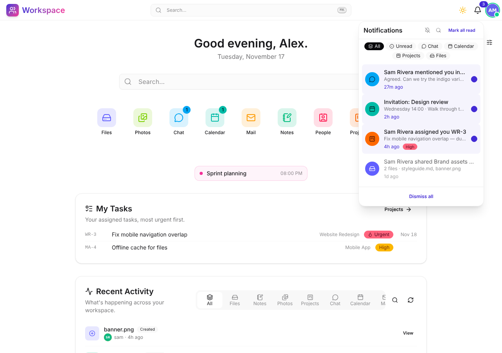

# Notifications

The bell in the top bar collects what the other modules have to tell a user:
a message, a share, an invitation, a task falling due. The same notifications
can reach their devices as Web Push, even when the app is closed.

## Notification center

- **Live**: the unread badge and the list update without a page reload, in
  every open tab.
- **Filters**: *All*, *Unread*, or one module at a time, plus a search on the
  title and text.
- **Opening** a notification marks it read and takes the user to what it is
  about. *Mark all read* clears the badge at once.
- **Grouping**: notifications about the same thing (a conversation, a task, a
  file) merge into one row instead of stacking, and clear on their own once
  the user opens that thing - reading the conversation, opening the email.
- **Priorities**: urgent and high notifications carry a badge, low ones are
  dimmed and never pushed.
- Read notifications are deleted after 90 days; unread ones are kept.

The dashboard tiles show the same unread counts per module (see
[Dashboard](../dashboard/)).

## What you are notified about

Each module decides, and most let the user choose how loud it is:

- **Chat**: new messages and mentions. The bell in a conversation's header sets
  it to every message, mentions only, or nothing.
- **Mail**: incoming mail, for every message, only when the AI classifier
  applies a label flagged as important, or never (mail preferences); a mail
  account that got disconnected.
- **Calendar**: invitations, updates, cancellations and replies, votes on a
  poll and changes to one, and a morning summary of the day's events.
- **Projects**: assignments, comments and mentions, changes on watched tasks,
  and a morning reminder of due and overdue tasks. Each project can be set to
  in-app and push, in-app only, or nothing.
- **Files**: shares, and edits, comments and deletions by others; files
  dropped through an upload link.
- **Photos**: albums shared with the user and photos added to them.
- **Imports**: an import that finished, failed or was stopped.

## Push notifications

The bell-ring button in the notification center turns push on or off for the
current browser; each device subscribes on its own. The button only shows in
browsers that support Web Push (on iPhone and iPad, Safari offers it to the app
once it is added to the Home Screen).

- While the user is active in Workspace, a push waits a minute and is only
  sent if the notification is still unread.
- One thing (a conversation, a task) sends at most one push a minute; urgent
  notifications always go through.
- Clicking a push opens the page it is about, in an open Workspace window if
  there is one.

## Administration

Push is off until the instance has a VAPID key pair. Generate one with
`python manage.py generate_vapid_keys` and set:

| Variable | Purpose |
|---|---|
| `WEBPUSH_VAPID_PRIVATE_KEY` | VAPID private key |
| `WEBPUSH_VAPID_PUBLIC_KEY` | VAPID public key (sent to the browser) |
| `WEBPUSH_VAPID_MAILTO` | Contact address required by the push protocol, as `mailto:admin@example.com` |

- The private key is accepted as raw base64url (what the command prints),
  base64url DER or a PEM block. Prefer the single-line form: `.env` files and
  container variables handle multi-line values inconsistently.
- **Regenerating the pair invalidates every existing subscription**: browsers
  store the public key, and every user has to turn push on again.
- Browsers only allow push on a site served over HTTPS (or `localhost`).
- Pushes are sent by the Celery worker, and the nightly clean-up of read
  notifications runs from Celery beat. When pushes never arrive, read the
  worker log first: an unparsable key, a missing `WEBPUSH_VAPID_MAILTO` and a
  push service refusing the request are all reported there.
- The Django admin lists notifications and push subscriptions; the *Send test
  push notification* action on a subscription checks delivery end to end.

The API is documented in the [Swagger UI](/schema/swagger-ui/).
