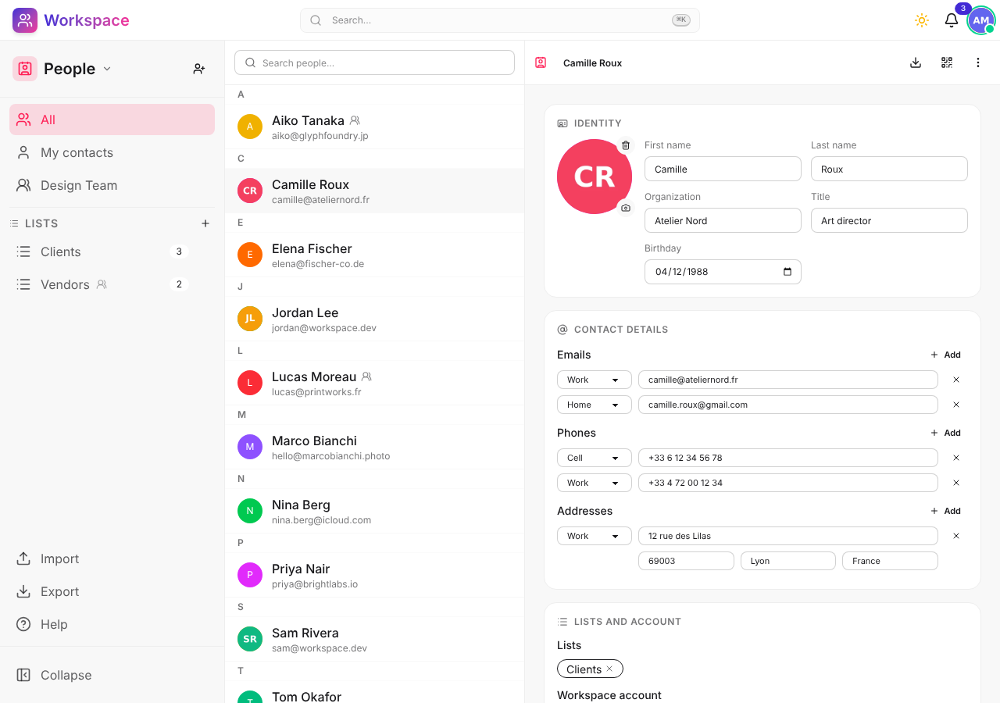
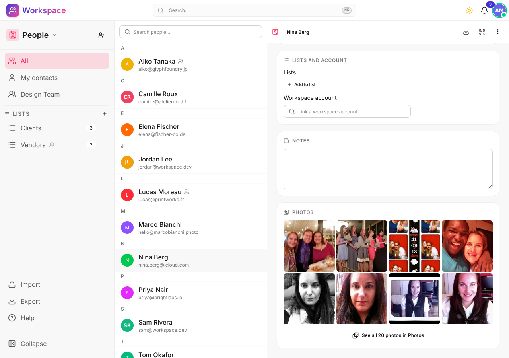

# People

The People module is an address book. Each user has one of their own, and
each group shares one. Contacts sync with phones and computers over CardDAV.
Mail, Calendar and Photos use them too.

## Address books

A contact belongs to one address book:

- **My contacts**, which only you see.
- **A group's book**, shared with every member of that group. Anyone who can
  see a book can edit its contacts: there are no roles inside a book.

The sidebar narrows the list to one book, and **All** shows every contact you
can reach. *Move to* in a contact's Actions menu moves it to another book.
The list is sorted alphabetically. The search box matches name, organization,
email and phone, and ignores accents: "helene" finds "Hélène".

## Contacts

Every field of a contact is edited in place in its panel:

- First and last name, organization, title and birthday.
- Several emails, phones and postal addresses, each with a type (work,
  home, cell...).
- Free-form notes.
- A photo, cropped when uploaded.
- **Workspace account**: links the contact to a user of the instance. The
  card then shows that account's picture and name. An account can be linked
  to only one contact per book.

## Lists

A list gathers contacts of one address book: family, clients, a team. Create
one with the **+** next to the *Lists* heading, and rename or delete it from
its row menu. Add a contact to a list from the contact's panel. A list only
takes contacts of its own book, and deleting it never deletes them. A group
icon marks a list that belongs to a group's book.

## Photos

When face grouping is on in Photos, a contact whose face was named there gets
a *Photos* section on their card. It shows the first photos they are in,
with a link to all of them in Photos. Each viewer only sees their own photos,
even on a shared contact. See [Photos](../photos/README.md#people).

## Import, export and QR code

- **Import** reads a `.vcf` file from a phone, Google Contacts or Nextcloud
  into an address book you choose. A contact that is already there (same card
  or same email) is updated instead of duplicated, so importing an updated
  file again is safe. Contact groups become lists, and photos come along.
  Properties the app has no field for are kept and written back on export.
- **Export** downloads one contact, a list, an address book or everything as
  a vCard 4.0 file, photos included. The dialog says how many contacts and
  lists it covers before downloading.
- **Show QR code** puts one contact on screen: another phone's camera reads
  it straight into its address book. The code can be downloaded as a PNG.

## Sync with your devices

The address books sync both ways with the contacts app of a phone or
computer, over CardDAV. The server address is `https://<your instance>/carddav/`.
Most clients find it from the instance's address alone.

- **iPhone, iPad, Mac**: add a CardDAV account with the server address.
- **Android**: use DAVx⁵ with the server address.
- **Thunderbird**: *New address book > Add CardDAV address book*, then the
  server address.

Sign in with your username and password. An account that signs in through
single sign-on uses an API token (*Settings > API Tokens*) as the password.
My contacts and each group's book appear as separate address books, and lists
sync as contact groups. The *Help* dialog in People shows the exact address
for the instance.

## Elsewhere in Workspace

- **Mail**: the To, Cc and Bcc fields suggest your contacts first, one line
  per address. Hovering a sender or a recipient shows the matching contact.
  From either place, a correspondent or a workspace account can be added to
  My contacts. A contact who already has that email or account is reused
  instead.
- **Calendar**: the invitee field searches contacts and lists along with
  workspace accounts. A contact without an account is invited as an external
  guest by email, and a list invites all its members.
- **Search**: contacts appear in the global search (Ctrl+K), matched the same
  way as in People.

The REST API is documented in the [Swagger UI](/api/schema/swagger-ui). For
developers: other modules add sections to a contact's card through the
registry in `workspace/people/sections.py`, which is how Photos adds its own.
