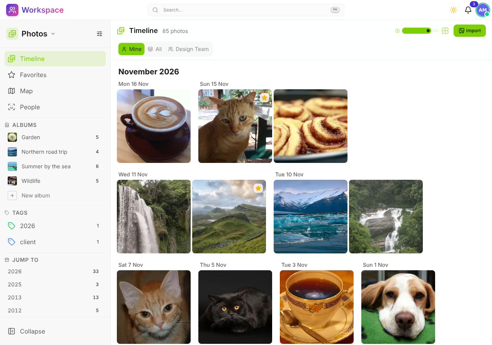
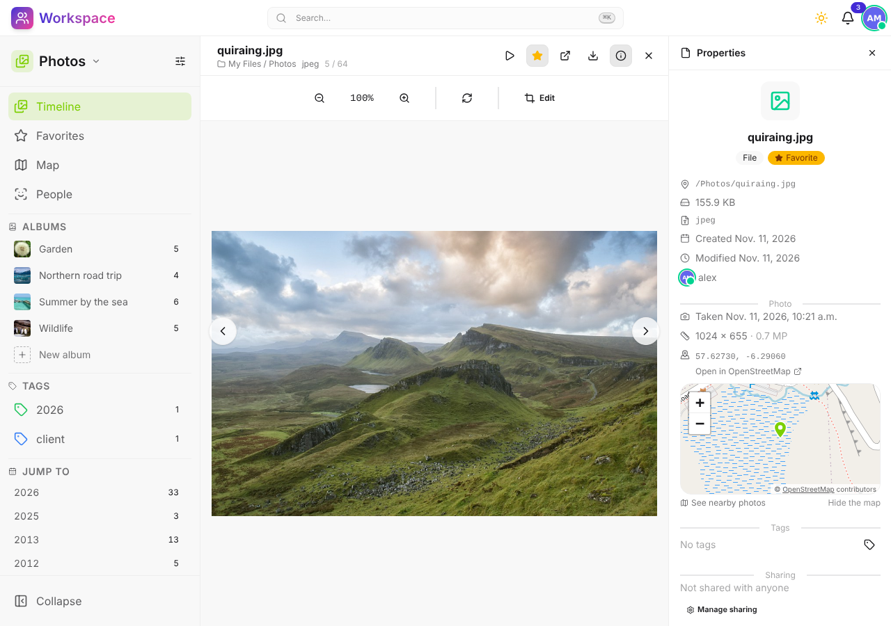
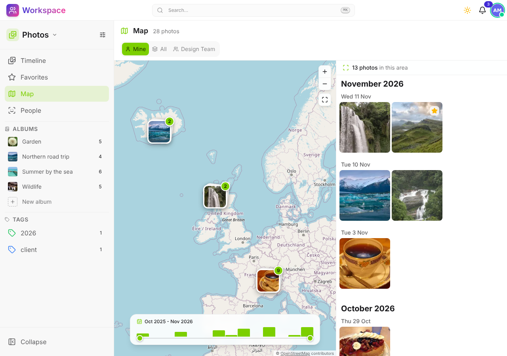
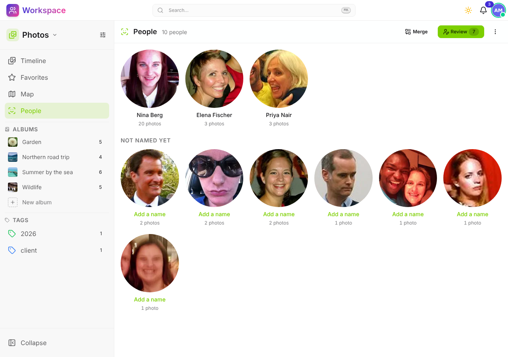
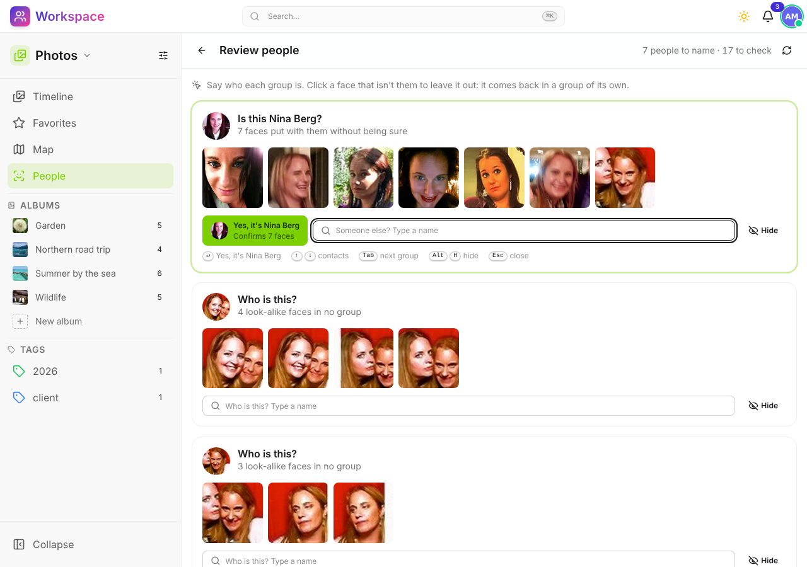

# Photos

The Photos module shows the photos and videos stored in Files as a timeline,
by the day they were taken: albums, a map, people, search by description. It
reads what is already in Files - nothing is copied - and every model it runs
is off until the instance turns it on.



The photos in these screenshots are licensed CC BY 2.0 by their authors, and
the map tiles are &copy; OpenStreetMap contributors: see
[the credits](../images/CREDITS.md).

## Timeline

Every photo and video a user keeps in Files is in their library, whatever
folder it sits in. The tabs above the timeline switch between the user's own
photos, those shared with them, a group's folder, or all of them.

- **Adding photos**: *Import* in the header, or a drop anywhere on the
  timeline, uploads to the import folder (`Pictures` by default, changed in
  the Preferences). The same panel gives the folder's WebDAV address, for a
  phone backup app such as PhotoSync or FolderSync.
- **Capture dates** come from EXIF for a photo and from the container for a
  video. Without them, a date in the file name stands in
  (`IMG_20230415_143022.jpg`, `WhatsApp Image 2023-04-15 at 14.30.22.jpeg`).
- **Edit date & location**, on one photo or a selection, shifts or sets the
  dates of a batch (a camera on the wrong clock, a pile of scans) and sets or
  removes a position. It never touches the file, and takes edit rights on it.
- **Hide** takes a photo or a whole folder out of the library without moving
  it in Files.

The viewer's properties panel shows when and where a photo was taken:



## Albums


An album gathers photos from anywhere in the library, without moving them.
It can be shared with users, groups and projects as viewer, contributor or
manager, and published through a link, with a password and an expiry if
needed. Whoever may not download gets the photos stripped of their metadata,
GPS position included. Members are notified when photos are added, and albums
play as a slideshow.

## Map



The **Map** page places every located photo and video of the library on a
map, grouped while they crowd; the grid beside it lists what the area on
screen holds, and a slider narrows both to a period. **See nearby photos**,
under a photo's own map in the viewer, opens the page around it.

The map needs a tile server set by the administrator (see
[Map tiles](#map-tiles)), and each user turns it on: the tile server learns
which areas they look at.

## People



Opt-in face detection groups the faces of a user's photos and videos by
person. Each group is named after a contact from the People module, and a
person's page is their own timeline.

- **Review** asks about everything the grouping is unsure of, one card per
  group of faces: *who is this?* The answer is a contact, a new name, or
  *Hide*. It runs from the keyboard.

  

- **Corrections** happen on a person's *Faces* tab: pick faces, then *Move
  to...*, *Not this person* or *Hide*. Every correction can be undone from its
  toast, and the grouping never moves a face the user placed.
- **People without a usable face** - seen from behind, too far, too blurred -
  are suggested by their clothes, as the person dressed alike on a photo of the
  same day. Suggestions only ever show up in the review.
- On the contact's page in People, a *Photos* section lists their photos, and
  their name in the global search opens them.

It only ever reads the user's own photos (never a group folder's nor a shared
one), runs on the server, and turning it off deletes every face, group and
vector. [Face grouping](face-grouping.md) explains how faces are grouped and
corrected.

## Search and similar photos

- **Search by description** in the Photos header ranks the library against a
  sentence: "dog on the beach", "birthday cake", in French too with the
  default model. The global search offers it as well.
- **Similar photos**, in a photo's menu, lists near-duplicates first (a burst,
  a re-export), then the photos that merely look alike.
- **Automatic tags** label photos with what they show (dog, beach, snow...)
  as ordinary file tags the user can remove. Users can turn them off in the
  Preferences.

Videos take part through their key frames: a result opens the video at the
moment that matched.

## Sensitive photos

A sensitive photo or video (nudity, a medical photo) is blurred wherever it
shows as a thumbnail - timeline, albums, search, Files, public links - and
opened behind a *Sensitive content* cover. Anyone with edit rights marks or
unmarks it from its menu. Each user picks how much is blurred on their own
screen (*Blur sensitive photos* in the Preferences, from Strict to Off),
and may unblur on hover or skip the cover.

With detection on, every photo gets a level from 0 to 4 automatically. A mark
set by hand always wins.

## Administration

Every feature that runs a model is off by default. All of them run in the
Celery worker, after an upload and in an hourly catch-up
(`python manage.py catch_up <faces|embeddings|auto_tags|sensitive|appearances>`),
and never in the web process.

| Feature | Turned on by | Runs |
|---|---|---|
| [Map](#map-tiles) | `PHOTOS_MAP_TILE_URL` and `PHOTOS_MAP_TILE_ATTRIBUTION` | Nothing on the server: the browser fetches tiles |
| [Search, similar photos, tags](#embeddings) | `PHOTOS_EMBEDDINGS_ENABLED=1` | An image embedding model |
| [Face grouping](#face-detection) | `PHOTOS_FACES_ENABLED=1`, then each user | A face detector and a face embedding model |
| [Sensitive photo detection](#sensitive-photo-detection) | `PHOTOS_SENSITIVE_DETECTION_ENABLED=1` | An image classifier |

Videos are analyzed only where `ffmpeg` and `ffprobe` are installed (the
Docker image ships them); elsewhere they are left out and never count as
pending. By default a video longer than 20 minutes or larger than 2 GB is not
read.

Weights download on first use into `PHOTOS_MODEL_DIR` (default `models/`
under `MEDIA_ROOT`) and are checked against pinned SHA-256 hashes. For a
worker without internet access, fetch them ahead of time with
`download_face_models`, `download_embedding_models` or
`download_sensitive_models`, or bake the face models into the image with
`docker build --build-arg FACE_MODELS=yunet_sface .`. The admin dashboard has
a card per feature saying whether its backend is configured and its weights
are present, and the Django admin lists what was analyzed, read-only
(*Face analyses*, *Photo embeddings*).

### Map tiles

There is no default tile server: every map opened sends the position on
screen to it, so pick one whose privacy and usage policy fit the instance - a
self-hosted one, or a provider you have an agreement with. A muted basemap
suits photos best, Esri's Light Gray and Dark Gray Canvas for instance (mind
their `{y}/{x}` order):

```bash
PHOTOS_MAP_TILE_URL='https://server.arcgisonline.com/ArcGIS/rest/services/Canvas/World_Light_Gray_Base/MapServer/tile/{z}/{y}/{x}'
PHOTOS_MAP_TILE_URL_DARK='https://server.arcgisonline.com/ArcGIS/rest/services/Canvas/World_Dark_Gray_Base/MapServer/tile/{z}/{y}/{x}'
PHOTOS_MAP_TILE_ATTRIBUTION='Tiles &copy; Esri, HERE, Garmin, &copy; <a href="https://www.openstreetmap.org/copyright">OpenStreetMap</a> contributors'
```

The OpenStreetMap server (`https://tile.openstreetmap.org/{z}/{x}/{y}.png`)
fits a small instance under its
[tile usage policy](https://operations.osmfoundation.org/policies/tiles/).
Most hosted basemaps want an account or a key for production use. Tile
requests carry the instance's origin as their Referer, never the page's URL.

| Setting | Default | Meaning |
|---|---|---|
| `PHOTOS_MAP_TILE_URL` | empty | Tile URL template (`{z}`, `{x}`, `{y}`, optionally `{s}`, `{r}`). |
| `PHOTOS_MAP_TILE_URL_DARK` | empty | The same map in a dark style, for dark themes. |
| `PHOTOS_MAP_TILE_ATTRIBUTION` | empty | Attribution shown on the map (HTML allowed). Required. |

### Embeddings

| `PHOTOS_EMBEDDING_BACKEND` | Model | Size | Weights licence |
|---|---|---|---|
| `siglip2_base` (default) | Google SigLIP 2 base, multilingual | 768-d | Apache-2.0 |
| `clip_vit_b32` | OpenAI CLIP ViT-B/32 | 512-d | MIT |
| `jina_clip_v1` | Jina CLIP v1 | 768-d | Apache-2.0 |
| `remote` | Any multimodal model behind an OpenAI-compatible `/embeddings` endpoint | `PHOTOS_EMBEDDING_DIMS` | The model's |

The local backends run on the CPU. SigLIP 2 is the most accurate, and the only
one usable for searches typed in French; CLIP costs a quarter of its CPU (about
90 ms a photo against 315 ms) for a smaller host. Each worker process keeps the
model in memory: raise `CELERY_WORKER_MAX_MEMORY_PER_CHILD` to 2.5 GB
(`2621440`) for SigLIP 2, 1.5 GB for CLIP. The
[embedding bench](embedding-bench.md) compares them.

**`remote` sends every photo and frames of every video to another service**,
as a downscaled JPEG. Only point it at an endpoint the users can trust with
their photos:

```bash
PHOTOS_EMBEDDING_BACKEND=remote
PHOTOS_EMBEDDING_BASE_URL=http://litellm:4000/v1
PHOTOS_EMBEDDING_MODEL=jina-clip-v2
PHOTOS_EMBEDDING_DIMS=1024
PHOTOS_EMBEDDING_API_KEY=...   # falls back to AI_API_KEY
```

A photo goes out as `{"model": ..., "input": ["data:image/jpeg;base64,..."]}`,
a search as plain text in `input`: the model must embed both into one space
(a CLIP, SigLIP or Jina CLIP model). It places no automatic tags, and its
distance thresholds are generic until measured with the bench
(`--backend remote`).

**Switching backend or model** makes every photo pending again: run
`python manage.py rebuild_vector_index` when the vector size changes, then
let the catch-up re-embed the library, or force it with
`python manage.py catch_up embeddings --reanalyze`.

| Setting | Default | Meaning |
|---|---|---|
| `PHOTOS_EMBEDDINGS_ENABLED` | off | Embed the photos and videos of the instance. |
| `PHOTOS_EMBEDDING_BACKEND` | `siglip2_base` | See above. |
| `PHOTOS_EMBEDDING_BASE_URL`, `_MODEL`, `_API_KEY`, `_DIMS` | | The remote endpoint. |
| `PHOTOS_EMBEDDING_REMOTE_IMAGE_SIZE` | `512` | Longest side of the copy sent to `remote`. |
| `PHOTOS_EMBEDDING_TIMEOUT` | `30` | Seconds per remote request. |
| `PHOTOS_EMBEDDING_QUERY_TIMEOUT` | `15` | Seconds a search waits for the worker. |
| `PHOTOS_EMBEDDING_MAX_FILE_BYTES` | 64 MB | Larger photos are not embedded. |
| `PHOTOS_VIDEO_KEY_FRAMES_MAX` | `12` | Most frames read from a video. |
| `PHOTOS_VIDEO_KEY_FRAMES_MAX_DURATION`, `_MAX_FILE_BYTES` | 20 min, 2 GB | Larger videos are skipped. |
| `PHOTOS_SIMILAR_MAX_DISTANCE`, `PHOTOS_DUPLICATE_MAX_DISTANCE`, `PHOTOS_DESCRIPTION_MAX_DISTANCE` | per backend | Distance thresholds, calibrated by the bench for each local model. |

### Face detection

A face embedding is biometric data. The instance allows the feature, each
user then turns it on from the People tab, which explains what is computed;
turning it off deletes everything.

| `PHOTOS_FACE_BACKEND` | Models | Size | Weights licence |
|---|---|---|---|
| `yunet_sface` (default) | YuNet + SFace (OpenCV Zoo) | 128-d | MIT / Apache-2.0 |
| `yunet_adaface` | YuNet + AdaFace IR-50 | 512-d | MIT, **trained on a non-commercial dataset** |
| `scrfd_arcface` | SCRFD + ArcFace (InsightFace `buffalo_l`) | 512-d | **Non-commercial research only** |

`yunet_adaface` groups about as well as `scrfd_arcface` for twice the
default's CPU, but whether WebFace4M's non-commercial licence reaches its
weights is not settled. `scrfd_arcface` is the most accurate on hard faces,
and must not be enabled on an instance run by or for a company. The
[face bench](face-bench.md) measures all three.

People without a usable face are found by their body too where photos are
embedded with a local model (a 3.8 MB person detector, about 25 ms a photo);
`PHOTOS_APPEARANCES_ENABLED=0` leaves it out.

**Switching backend**: `python manage.py rebuild_vector_index`, then
`python manage.py catch_up faces --reanalyze`. User corrections survive the
reanalysis.

| Setting | Default | Meaning |
|---|---|---|
| `PHOTOS_FACES_ENABLED` | off | Offer face grouping on the instance. |
| `PHOTOS_FACE_BACKEND` | `yunet_sface` | See above. |
| `PHOTOS_APPEARANCES_ENABLED` | on | Also find people by their clothes. |
| `PHOTOS_MODEL_DIR` | `MEDIA_ROOT/models` | Where weights are downloaded. |
| `PHOTOS_ONNX_THREADS` | `1` | Threads per model; keep 1 with several worker processes. |
| `PHOTOS_FACES_DECODE_SIZE` | `1600` | Longest side, in px, detection runs on. |
| `PHOTOS_FACES_MAX_FILE_BYTES` | 64 MB | Larger photos are not read. |
| `PHOTOS_FACES_MIN_SIZE` | `24` | Smaller faces (px, at the decode size) are dropped. |
| `PHOTOS_FACES_MAX_PER_PHOTO` | `40` | Most faces kept per photo. |
| `PHOTOS_FACES_MAX_DISTANCE` | per backend | Distance under which two faces are one person. |
| `PHOTOS_FACES_CLUSTER_PENDING` | `50` | Ungrouped faces that trigger a grouping run before the nightly one. |
| `PHOTOS_FACES_VIDEO_*` | | Frame size, interval, count and video limits for faces in videos. |

### Sensitive photo detection

The detector is [Falconsai's NSFW classifier](https://huggingface.co/Falconsai/nsfw_image_detection)
(ViT-base, Apache-2.0, 87 MB, about 120 ms a photo). It was trained on
nudity only: a medical or gory photo is marked by hand. On 2,000 ordinary
Open Images photos it blurs 0.5% at the default step; its recall on explicit
photos has not been measured here. A video gets the score of its worst key
frame.

| Setting | Default | Meaning |
|---|---|---|
| `PHOTOS_SENSITIVE_DETECTION_ENABLED` | off | Check every photo and video of the instance. |
| `PHOTOS_SENSITIVE_BACKEND` | `falconsai_vit` | The detector. |
| `PHOTOS_SENSITIVE_MAX_FILE_BYTES` | 64 MB | Larger photos are not checked. |
