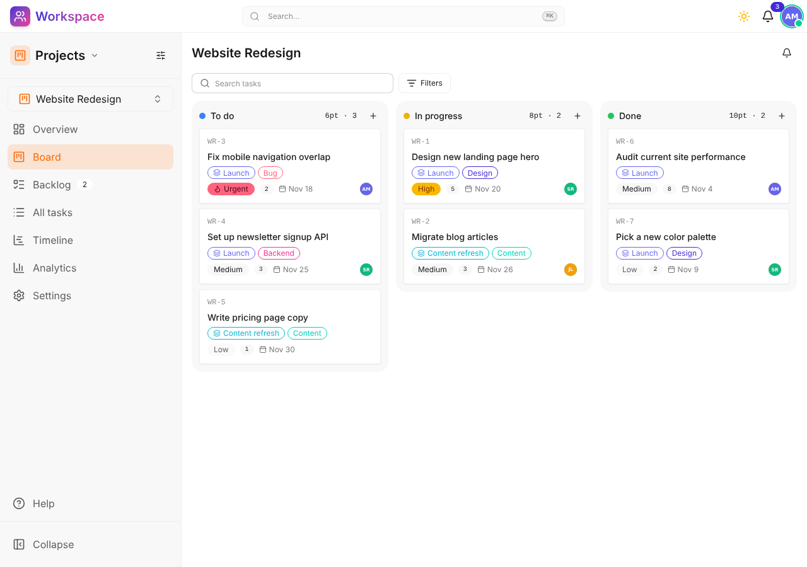
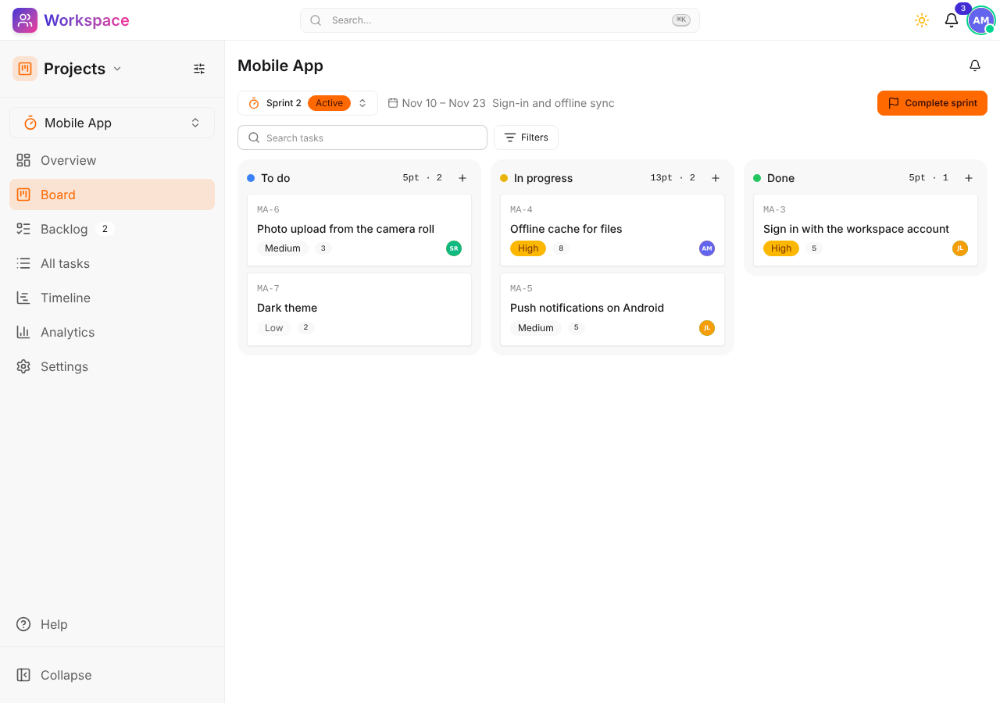
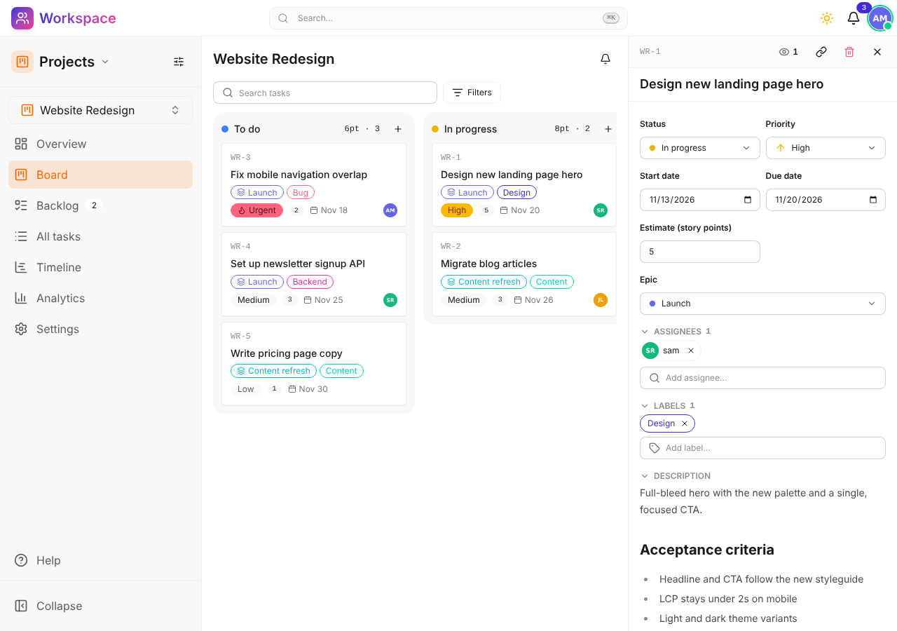
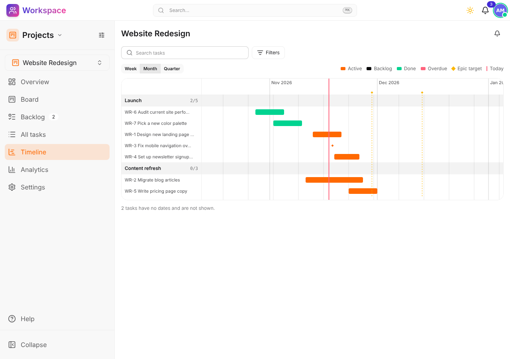
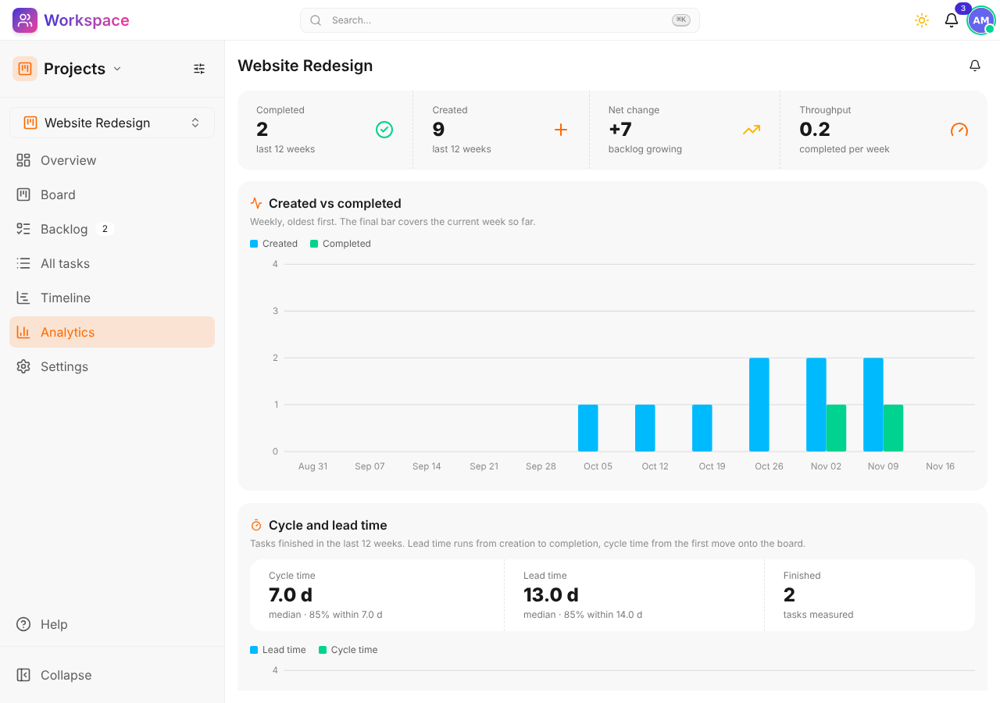

# Projects

The Projects module tracks tasks on boards, solo or as a team. A project
runs as a continuous kanban board or in timeboxed sprints. It also has a
backlog, a timeline and reports. Every user gets a personal project the
first time they open the module.

## Projects and members

- **Personal project**: private to its owner. It cannot take members, be
  archived or be deleted.
- **Shared projects**: *New project* in the sidebar creates one, as a
  *Continuous board* (kanban) or with *Timeboxed sprints* (scrum). Admins add
  people one by one as Admin or Member, or attach a group so that each of its
  members gets member access. A group never makes anyone an admin.
- **Archiving** makes a project read-only for everyone until an admin
  unarchives it. Archived projects are left out of search.

| Role | Can |
|---|---|
| Member | Open the project. Create, edit, move, plan, comment on and delete tasks |
| Admin | Also edit the project settings, columns, labels, epics, sprints, members and groups, switch the board model, archive and delete the project |

## Board, backlog and task lists

- **Board**: columns of active work. Drag a card to another column or to a
  new place in its column. A card shows its reference, priority, due date,
  assignees, labels, epic, estimate and checklist progress. It is flagged
  *Blocked* while an open task blocks it.
- **Columns** belong to one of three categories: Backlog, Active or Done.
  Admins add, rename, recolor and reorder them in the project settings.
- **Done retention**: each project picks how long completed tasks stay in the
  Done columns, from 1 day to forever. An older task leaves the board but is
  kept: it still counts in the reports and opens from search and links.
- **Backlog**: tasks that are not planned yet. *Send to board* (or to a given
  column) moves selected tasks to the board. On a sprint project, *Send to
  sprint* plans them instead.
- **All tasks**: every task of the project in one flat list, grouped by
  column.
- **Filters**: text, assignee (or unassigned), priority, label, epic and, in
  the lists, status. They apply on the server, so a filtered view keeps its
  URL across a refresh and can be shared.
- **Bulk edit**: in the backlog and the all-tasks list, select tasks to
  assign or unassign a member, add or remove a label, or set the priority or
  due date. Selected tasks can also be deleted, after a confirmation.
- **Estimates**: off until an admin picks a unit in the settings, story
  points or hours. Each board column and each sprint shows its total.
- **Overview**: the project's home page. It shows task counts, the
  description, members, labels, open epics with their progress, and recent
  activity.

## Sprints

On a sprint project, the board shows the active sprint's tasks only:

- Admins create sprints from the sprint switcher. A new sprint comes with the
  next name and dates already filled in, and can have a goal.
- Members plan tasks into a sprint from the backlog.
- Admins start a planned sprint from the board.
- *Complete sprint* asks what to do with unfinished tasks. They go back to the
  backlog, or move into another open sprint, where each task keeps its column.
  Closed sprints can still be browsed from the switcher.

An admin can switch a project between kanban and sprints at any time in its
settings. Tasks, columns, comments and history are kept.

## Tasks

Clicking a task opens its panel beside the board. The panel has its own URL
and closes with the browser's back button. Every field is edited in place,
and each section folds:

- **Status, priority** (Low, Medium, High, Urgent), **start and due dates,
  estimate, assignees, labels and epic**.
- **Description** in Markdown, and a **checklist** that can be reordered by
  dragging.
- **Linked tasks**: *blocks*, *duplicates* or *relates to*. Each task shows
  the link from its own side (*is blocked by*, ...).
- **Attachments**: a file uploaded or copied from Files, stored on the task.
  Everyone who can open the task can open it.
- **Linked files**: *Link file* shares a file from Files with the project and
  pins it on the task, as view-only or editable. Nothing is copied, so renames
  and edits follow. The share shows on the file like any other share.
  Removing the last link lifts it, unless the file was already shared with
  the project before.
- **Comments**: `@` mentions notify the person mentioned. Only people who can
  see the project can be mentioned.
- **Activity**: the task's history. Project activity also appears on the
  dashboard and in the profile feed.

**References**: every task has a reference made of the project key and a
number, like `WR-42`. A personal project's key comes from its owner's
username. Numbers are never reused. Typing a reference, or a bare number, in
the search palette (Ctrl+K) opens the task, and `?task=WR-42` at the end of a
project URL links to it. Admins can change the key in the settings.

## Epics and timeline

An epic groups tasks under a name and a color. It can have a description and
a target date, and can be closed. Admins manage epics in the project
settings, and the overview shows how many of each epic's tasks are done.

The **Timeline** places tasks on a date axis, grouped by epic. A task with a
start and a due date is drawn as a bar, and a task with one date as a point.
Overdue tasks are shown in red. Dated epics are milestone markers, and on a
sprint project each sprint is a band. It zooms between week, month and
quarter, and follows the filters.

## Analytics

Every project has an Analytics page built from its task history. It works
for existing projects too, and deleted tasks still count:

- Tasks created and completed per week over the last 12 weeks, with
  throughput.
- Open tasks by column, by assignee and by priority.
- Cycle and lead time: the median, the 85th percentile, and how tasks are
  spread across durations.
- A cumulative flow diagram.
- On sprint projects, a burndown of the chosen sprint and the velocity of
  closed sprints (in tasks, points or hours).

## Notifications

You are notified when you are assigned a task or mentioned. Watching a task
also notifies you of its comments, moves and completion. Commenting on a task
or being assigned to it starts watching it, unless you turn that off in the
preferences. From the task panel you can watch a task or mute it.

- **Due reminders**: assignees and watchers get one reminder when a task
  falls due and one when it becomes overdue. Each is sent after the hour you
  pick in the preferences (8:00 by default), in your own time zone.
- **How much**: *All* (in-app and push), *In-app only* or *Nothing*. This
  applies to every project, and the bell in a project's header can override it
  for that project.

## Elsewhere in Workspace

- **Dashboard**: the *My tasks* widget lists your open assigned tasks,
  overdue ones first.
- **Calendar**: the due dates of open tasks in your projects show as
  all-day items. A switch in the calendar sidebar hides them.
- **Search**: projects and tasks appear in the global search, by title,
  description or reference.
- **AI assistant**: it can list your tasks, search them, and create, move,
  update or comment on tasks. It is limited to the projects you can open.
- **Sharing**: a file, folder or photo album can be shared with a project.
  This reaches every member.

The REST API is documented in the [Swagger UI](/schema/swagger-ui/).
