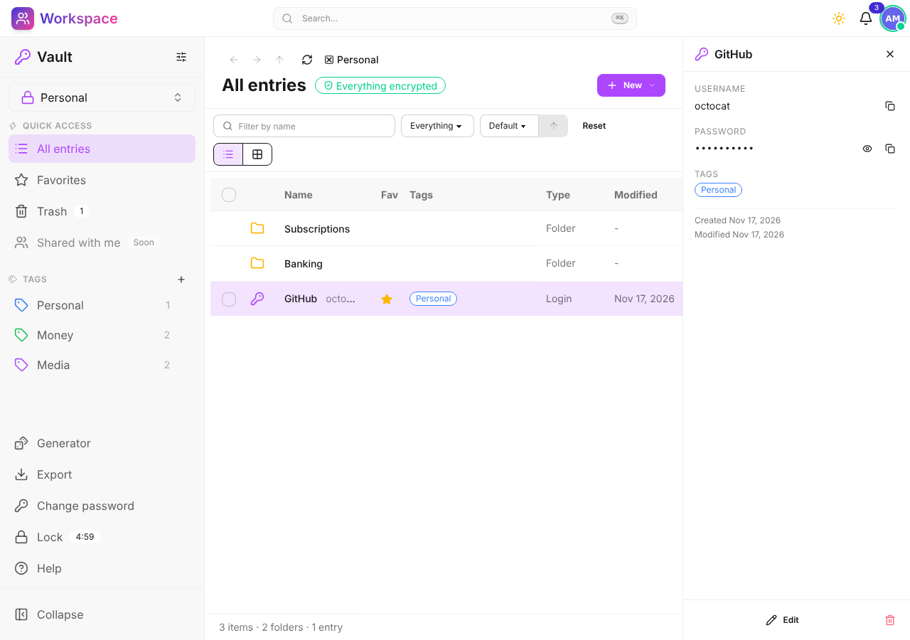

# Vault (preview)

The Vault is an end-to-end encrypted password manager. Logins, passwords,
authenticator keys and notes are encrypted in the browser before they are
sent, so the server stores what it cannot read. It is a preview: the module
works, but some features (sharing a vault with someone else, importing) are
not built yet.

## Getting started

The first visit to the Vault walks through three steps:

1. **How it works**: one master password opens every vault of the account. It
   is not the Workspace password, and changing one never changes the other.
2. **Master password**: at least 12 characters, strong enough to resist
   guessing, and not found in known data breaches. The breach check sends only
   the first five characters of a hash of the password, never the password.
3. **Recovery key**: generated in the browser and shown once. *Download the
   emergency kit (PDF)* saves it. The recovery key is the second half of the
   lock, not a way to reset the password: it is needed together with the master
   password on any new device.

*Remember my recovery key on this device* spares typing it again on that
browser. Anything that can run code on the page can then read it, so leave it
off on a shared computer. The setup ends by creating a first vault called
*Personal*.

## Unlocking and locking

- **Unlocking** asks for the master password, and for the recovery key unless
  this device remembers it. It takes a few seconds on purpose: that delay is
  what makes guessing the password expensive.
- **The vault locks itself** after a few idle minutes (1, 5, 15 or 60, five by
  default, in the sidebar's Preferences), when the tab is hidden, and when the
  page is left or reloaded. The countdown sits beside *Lock* in the sidebar.
  Locking empties the screen and drops the keys from memory.
- A remembered recovery key can be replaced or forgotten from the unlock
  screen, or forgotten from Preferences (*Forget the key*). That only changes
  what the device remembers; the key itself is changed from the sidebar (see
  *Replacing the recovery key*).
- The command palette (Ctrl+K) offers *Vault*, *Lock vault* and *New entry*.

## Vaults

An account can hold several vaults, all opened by the same master password.
The switcher at the top of the sidebar creates one (name, description, icon,
colour) and moves between them without unlocking again. Each vault's menu
renames it, changes its icon and colour, marks it as a favourite, or deletes
it with everything in it - that cannot be undone. The Vault opens on the
vault last used on this device, or else on a favourite.

Sharing a vault with another account is not built yet: *Shared with me* in the
sidebar is a placeholder.

## Entries

An entry is a login: a name, a username, a password, an authenticator key, a
website and notes, plus its folder, tags and a favourite flag.

- **New** in the header creates a login or a folder. The password field has a
  generator beside it.
- **Authenticator key**: paste the key or the `otpauth://` address a site shows
  when two-factor authentication is set up. The entry then shows the current
  one-time code.
- **The side panel**, opened by clicking an entry, copies the username, the
  password or the authenticator code, reveals the password or the key, and
  opens the website. A copied value is cleared from the clipboard after 30
  seconds, or at once with *Clear now*; locking clears it too.
- **Browsing**: a list or a mosaic of tiles, filtered by name or username,
  narrowed to folders, entries or favourites, and sorted by name, favourite,
  creation or modification date. The default sort is in Preferences.

## Folders, tags and trash

- **Folders** nest. Create one from *New* or a right-click on the listing,
  rename or delete it from its own menu; deleting a folder moves its entries to
  the vault root. Entries move by dragging them onto a folder, or with *Move to
  folder* on a selection.
- **Tags** are created from the sidebar, with a colour, and put on entries from
  the entry form or *Edit tags* on a selection. Clicking a tag in the sidebar
  shows its entries; deleting a tag removes it from every entry.
- **Favorites** lists the starred entries.
- **Trash** keeps deleted entries until they are restored, deleted
  permanently, or the trash is emptied. Nothing is purged automatically.

## Password generator

*Generator* in the sidebar draws a password (length, upper case, lower case,
digits, symbols, look-alike characters left out) or a passphrase (number of
words, separator, capitals), shows its strength in bits, and copies it. The
same panel opens beside an entry's password field.

## Changing the master password

*Change password* in the sidebar asks for the current password (and the
recovery key, unless this device remembers it) and a new one under the same
rules as the setup. The recovery key does not change. The vault then locks and
asks for the new password. Until the new password has been used once, the old
one still opens the account, with a banner saying so.

## Replacing the recovery key

*Recovery key* in the sidebar replaces the key when someone else may have seen
it: a lost emergency kit, a photo of it, a shared computer that remembered it.
It is also the way back to an emergency kit when the sheet is lost and a device
still remembers the key.

It asks for the master password (and the current recovery key, unless this
device remembers it), then shows the new key once, with a new emergency kit to
download. Nothing changes until the key is confirmed as saved: closing the
dialog before that leaves the old key in place, and a kit saved in the meantime
opens nothing. If the connection drops at the moment of the replacement, the
page says it could not check what happened, and the next unlock on that page
says which key is in place.

The vault then locks and asks for the new key. Until the new key has been used
once, the old one still opens the account, with a banner saying so. After that,
a device that remembered the old key is asked for the new one. The master
password does not change, and no vault is re-encrypted.

## Export

*Export* in the sidebar writes everything the account holds to a file, in one
of two forms:

- **Encrypted archive** (`.vaultarchive`): every vault, folder, tag and entry,
  trash included, sealed with a passphrase chosen for the export (the generator
  is offered). Nothing else protects the file: keep the passphrase with the
  emergency kit. This is the backup format.
- **Readable by another password manager**: a JSON file in Bitwarden's format,
  without the trash, for moving to another tool. It is not encrypted - every
  password in it can be read - and the dialog asks for a confirmation first.

Workspace cannot import either file yet.

## Security model

- Everything is encrypted and decrypted in the browser. The master password
  and the recovery key never leave it, and the server holds no key that could
  open a vault.
- The server cannot read vault, folder, tag or entry names, usernames,
  passwords, authenticator keys, websites or notes. It does see the shape of
  the data: how many vaults, folders and entries there are, how folders nest,
  which tags an entry carries, favourites, the trash, dates, the icons and
  colours of vaults and tags, and which kinds of field an entry fills in.
- Every record is signed by the account. A record the server altered or
  forged is removed from the list, with a banner saying how many, and never
  decrypted.
- **Nothing can be reset.** Unlocking takes both the master password and the
  recovery key (or a device that remembers the key). Lose the password, or
  lose the key with no device remembering it, and nobody - administrators
  included - can open the vaults again. An encrypted archive is the only
  backup that survives that.

[Vault cryptography](CRYPTO.md) describes the key hierarchy, the algorithms and
the file formats.

## Administration

The Vault needs no worker, no model and no server-side key. What an
administrator decides:

- **Who sees it.** Like every preview module it is shown only to the audience
  of `PREVIEW_VISIBILITY` (`all`, `staff`, `admin` or `none`; `staff` by
  default). Outside it the module is hidden and its pages and API answer 404.
- **The breach check** is made by each user's browser against
  `api.pwnedpasswords.com`, which the module's Content-Security-Policy allows.
  Where that host is unreachable the check is skipped with a warning and does
  not block the password.
- **Rate limits** guard the account endpoints, per user and per IP
  (`vault.*` in `REST_FRAMEWORK['DEFAULT_THROTTLE_RATES']`). Behind a reverse
  proxy set `NUM_PROXIES`, or every user shares the proxy's address and its
  limits (see [the deployment guide](../deployments/README.md)).
- **The Django admin** lists account identities, vaults, key wraps and entries
  for diagnostics, read-only: what they hold is ciphertext, and an edit would
  only break a signature. Deleting is allowed. A user who lost their master
  password or recovery key can only start over: delete their account identity
  and their vaults, and the next visit walks the setup again with nothing in
  it.
- **Backups**: the vault lives entirely in the database; it stores no files.
- **Retiring an algorithm** is described in
  [Vault cryptography](CRYPTO.md#retiring-an-algorithm):
  `python manage.py vault_suite_census` counts what is still stored under each
  one.
